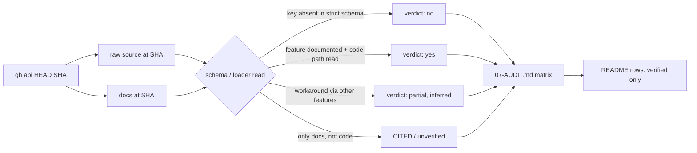

# Phase 7: Competitor Composition Audit - Research

**Researched:** 2026-11-02
**Domain:** Competitive analysis (docs + source reading) of Ruler and rulesync against ruly's recipe/`requires:` composition model
**Confidence:** HIGH for "no" verdicts on profiles, includes, and cycles (strict schemas read in source). MEDIUM for the "partial" workaround verdicts (inferred from docs and schema, not run).

## Summary

This phase is itself research. The question was: can Ruler or rulesync select rules per task the way ruly's recipes and `requires:` do? Both repos were read at a pinned commit (docs plus config/loader source). **Neither tool has named rule sets or profiles, frontmatter includes with transitive resolution, or cycle detection.** In Ruler, `ruler.toml` is a `.strict()` zod schema with no rule-selection key, and every `.md` under `.ruler/` is concatenated. In rulesync, the rule frontmatter schema has no `requires`/`include` key, and the config schema has no `profiles`/`presets` key. So ruly's main advantage from the 2026-11-01 research holds.

Two of the earlier claims need correcting before they go in the README. (1) **Per-subagent model selection is not unique to ruly.** Ruler has a `model:` field on each `.ruler/agents/*.md` subagent. rulesync has per-tool `claudecode.model`, `copilotcli.model`, and so on. What *is* unique to ruly is binding a separately compiled **recipe** (its own rule set) to each subagent. (2) **rulesync has a cross-machine shared-source mechanism equal to or stronger than ruly's.** It has declarative `sources` (GitHub/git/npm, SHA-pinned in `rulesync.lock`), `--input-roots` overlays where later trees replace files, and `rulesync.local.jsonc` per-machine config overrides. Ruler has neither remote sources nor overlays. It only falls back to `$XDG_CONFIG_HOME/ruler` when no local `.ruler/` exists.

The earlier "no rivals advertise post-compile checks" also needs nuance. rulesync has `generate --check` (drift), `doctor` (config lint plus a Codex AGENTS.md byte budget), and AGENTS.md overwrite-collision warnings. Ruler validates skill and subagent sources. Only ruly validates **anchor links** in the compiled output. On agent coverage ruly is far behind: Ruler has 32 agents and rulesync has 69 `--targets` values (61 with project-mode rules). Both ship AGENTS.md, and ruly 0.3.0 now does too via `-a agents`.

**Primary recommendation:** Write 07-AUDIT.md from the matrix below. In the README, add a short "Ruly vs. Ruler and rulesync" table with only the verified rows. Claim uniqueness for recipes/profiles, transitive `requires:`, cycle reporting, per-subagent recipe binding, and anchor-link checks. Concede agent coverage, and concede that rulesync matches or beats ruly on shared sources with overrides.

## Architectural Responsibility Map

| Capability | Primary Tier | Secondary Tier | Rationale |
|------------|-------------|----------------|-----------|
| Evidence gathering (SHAs, source files, docs) | Research (this file) | — | Read-only `gh api` and docs reading; no execution |
| Capability matrix and verdicts | Docs: `07-AUDIT.md` | — | Planner deliverable per CONTEXT.md |
| Public positioning | Docs: `README.md` "Ruly vs." section | — | Only verified rows (CONTEXT.md decision) |
| Open-question closure | Docs: `.planning/research-competitive-2026-11-01.md` | — | CONTEXT.md deliverable |
| ruly code | none | — | Phase is "no ruly code changes" |

<user_constraints>
## User Constraints (from CONTEXT.md)

### Locked Decisions
### Method
- Read each project's docs AND source at a recorded commit SHA (cite SHA + file paths); docs claims alone are insufficient
- Where feasible, run each tool via `npx` in a scratch dir against a small fixture to confirm behavior (no global installs)
- Capability matrix rows: named rule sets/profiles, per-task selection, include/require with transitive resolution, cycle detection, per-subagent model selection, cross-machine shared source + per-machine overrides, post-compile checks, agent coverage

### Deliverables
- `.planning/phases/07-competitor-composition-audit/07-AUDIT.md` with the matrix, evidence links, and verdict per row (yes / partial / no / unverified)
- Update README "Ruly vs." section: add competitor comparison ONLY for rows with verified evidence; keep wording factual
- Update `.planning/research-competitive-2026-11-01.md` open question with the answer (or a follow-up note)

### Claude's Discretion
- Whether to also cover vibe-rules (only if time allows; mark as out of scope otherwise)

### Deferred Ideas (OUT OF SCOPE)
- Interop (handing AGENTS.md to Ruler/rulesync for fan-out) — future milestone
</user_constraints>

**Orchestrator override for this run (method limitation, must be recorded in 07-AUDIT.md):** The "run each tool via `npx`" item is **dropped**, because executing third-party code is not permitted in this run. All evidence comes from reading docs and source at a pinned SHA via `gh api` and WebFetch. Behavior that could only be inferred, not read, is marked `unverified` or "inferred".

**vibe-rules:** out of scope (discretion item; not covered).

## Project Constraints (from CLAUDE.md)

- When CLI commands change, update README.md. Not applicable: no CLI change in this phase.
- Use Mermaid for diagrams in rules (README/docs may stay tables).
- Commits: "commit all" means both repos. This phase touches only the parent repo's `.planning/` and `README.md`, not `rules/`.
- Do not edit `CLAUDE.local.md`.
- GSD workflow enforcement: edits go through `/gsd-execute-phase`.
- Global user instruction: keep wording brief and factual (matches the CONTEXT "keep wording factual" decision).

## Pinned Evidence Baseline

| Project | Repo | Commit inspected | Commit date | Latest release | Stars / forks (2026-11-02) |
|---|---|---|---|---|---|
| Ruler | intellectronica/ruler | `5e551e60952fb1c81c6c5ad6f5fe8b7a412bda87` | 2026-10-27 | v0.3.46 (2026-10-22) | 2,956 / 165 |
| rulesync | dyoshikawa/rulesync | `6e3869d378066dc2f0b4cda3896e444ae7f200a7` | 2026-11-02 | v43.4.2 (2026-11-01) | 1,577 / 168 |
| ruly | this repo, branch `gsd/competitive-positioning` | `4e859914ea87025b8d4d378f8752da7cf42c084b` | — | 0.3.0 (`lib/ruly/version.rb:4` `VERSION = '0.3.0'`) | — |

[VERIFIED: `gh api repos/<owner>/<repo>/commits/HEAD`, `gh api repos/<owner>/<repo>`, `releases/latest`, run 2026-11-02]

Evidence URLs below use the form `https://github.com/<owner>/<repo>/blob/<SHA>/<path>#L<a>-L<b>`. Ruler base is `https://github.com/intellectronica/ruler/blob/5e551e60952fb1c81c6c5ad6f5fe8b7a412bda87/`. rulesync base is `https://github.com/dyoshikawa/rulesync/blob/6e3869d378066dc2f0b4cda3896e444ae7f200a7/`.

## Capability Matrix (the core finding; drop into 07-AUDIT.md)

Verdicts: yes / partial / no / unverified. "Inferred" means the conclusion follows from the code/docs read but the behavior was not executed.

| # | Capability | Ruler @5e551e6 | rulesync @6e3869d | ruly 0.3.0 @4e85991 |
|---|---|---|---|---|
| 1 | Named rule sets / profiles selectable per invocation | **no** | **no** (partial workaround, inferred) | **yes** |
| 2 | Per-task selection (subset of rules for one run) | **no** | **partial** | **yes** |
| 3 | Include/require between rule files, transitive | **no** | **no** | **yes** |
| 4 | Cycle detection in includes | **no** (n/a: no includes) | **no** (n/a: no includes) | **yes** (reported by `ruly stats`; squash dedups) |
| 5 | Per-subagent model selection | **yes** | **yes** | **yes** (plus a recipe per subagent; neither rival has this) |
| 6 | Cross-machine shared source + per-machine overrides | **no** (machine-wide fallback dir only) | **yes** | **yes** |
| 7 | Post-compile checks | **partial** (source validation; no link checks) | **partial** (drift, config lint, size budget; no link checks) | **yes** (anchor links, duplicate skill requires) |
| 8 | Agent coverage / AGENTS.md | **32 agents; AGENTS.md yes** | **69 targets (61 with rules); AGENTS.md yes** | **3 targets (claude full; agents = AGENTS.md; cursor partial)** |

### Row-by-row evidence

#### 1. Named rule sets / profiles

- **Ruler: no.** `ruler.toml` is validated by a `.strict()` zod schema. Its only top-level keys are `default_agents`, `agents`, `mcp`, `mcp_servers`, `gitignore`, `backup`, `skills`, `subagents` (deprecated), and `nested` (`src/core/ConfigLoader.ts#L75-L129`). None of them selects rule files or names a profile. [VERIFIED: read src/core/ConfigLoader.ts @5e551e6]
  - `--config <path>` only swaps which `ruler.toml` is read. The rules directory is located separately by `findRulerDir(projectRoot, …)`, and all of its markdown is read regardless of the config (`src/core/apply-engine.ts#L319-L351`; `findRulerDirectories` at `#L264-L288`). The README example `ruler apply --config ./team-configs/ruler.frontend.toml` therefore changes agents/MCP settings, not the rule set. [VERIFIED: read apply-engine.ts]
- **rulesync: no.** `ConfigParamsSchema` keys are `outputRoots, targets, features, verbose, delete, global, silent, simulateCommands, simulateSubagents, simulateSkills, preserveUnownedHooks, deriveSubprojectPathFromGlobs, flattenedCommandNaming, language, gitignoreTargetsOnly, gitignoreDestination, dryRun, check, inputRoot, inputRoots, sources` (`src/config/config.ts#L118-L180`). There is no profile or preset key. [VERIFIED: read src/config/config.ts @6e3869d]
  - Workaround (inferred, not executed): keep several config files and select one with `generate -c <path>` (`src/cli/program.ts#L342`), each with its own `inputRoots`. That gives a directory-granular "profile", with no name registry and no dependency resolution. [ASSUMED: combination inferred from schema + docs]
- **ruly: yes.** `ruly squash [RECIPE]` (`lib/ruly/cli.rb:54` `def squash(recipe_name = nil)`). Recipes are loaded from mirrored remotes / project / user files (`lib/ruly/services/recipe_loader.rb:100-116`). [VERIFIED: read]

#### 2. Per-task selection

- **Ruler: no.** `readMarkdownFiles` recursively collects **every** `.md` under the `.ruler/` dir. It skips only `skills/`, and `agents/` unless `include_in_rules` is set (`src/core/FileSystemUtils.ts#L319-L436`). `--agents` selects target **agents**, not rules (README "Options" table). Nested mode (`--nested`) loads per-**directory** `.ruler/` trees (path scoping, like Claude's `paths:`), not per-task sets (README "Nested Rule Loading"; `findAllRulerDirs` `FileSystemUtils.ts#L611-L656`). [VERIFIED: read]
- **rulesync: partial.**
  - A rule's frontmatter `targets:` picks which **tools** get it, and `globs` gives path scoping (`src/features/rules/rulesync-rule.ts#L34-L39`: `root`, `localRoot`, `targets`, `description`, `globs`, then per-tool blocks). [VERIFIED: read]
  - `--input-roots <paths...>` composes one or more source trees **per invocation**, with later trees replacing files of the same path (`docs/guide/separate-input-root.md` "Combining multiple source trees"; `program.ts#L356-L359`). A base tree plus a task tree is possible, but selection is by directory, with no per-file list and no dependencies. [VERIFIED: read docs + CLI source]
  - `sources[].rules: [...]` selects named remote rules, but at **install** time into `.rulesync/rules/.curated/`, not per run (`docs/guide/declarative-sources.md`, property table). [VERIFIED: read docs]
  - `--features rules` / `--targets` narrow features and tools, not rules.
- **ruly: yes.** A recipe lists files/dirs/skills/commands/MCP. Only those plus their `requires:` closure are written (README "Ruly vs. native Claude Code" row "Per-task selection"; `recipe_loader.rb:260` `process_recipe_files`). [VERIFIED: read]

#### 3. Include/require with transitive resolution

- **Ruler: no.** `concatenateRules` just joins files with `<!-- Source: … -->` markers (`src/core/RuleProcessor.ts#L7-L28`, whole file read). There is no include/import parsing. A code search of the repo for `@import` returns 0 hits. [VERIFIED: read + `gh api search/code`]
- **rulesync: no.** The rule frontmatter schema has no `requires`/`include`/`imports` key (`rulesync-rule.ts#L34-L257`; top-level keys listed above plus per-tool blocks `agentsmd, claudecode, codebuddy, cline, continue, cursor, trae, copilot, antigravity, aiassistant, devin, qoder, augmentcode, kiro, pi, roo, takt, factorydroid`). Code search for `@import` returns 0 hits. [VERIFIED: read + code search]
  - Avoid a false positive: `takt.extends` only **emits** a `{extends:<parent>}` directive into Takt output for Takt to interpret (`rulesync-rule.ts` ~L228-L234, comment "Facet inheritance: emit a leading `{extends:<parent>}` directive (Takt 0.39.0+)"). rulesync does not resolve it.
- **ruly: yes.** `DependencyResolver.resolve_requires_for_source` reads `frontmatter['requires']` and skips keys already in `processed_files` (`lib/ruly/services/dependency_resolver.rb:10-25`). `SourceProcessor` pushes the requires to the front of the queue for depth-first transitive processing (`lib/ruly/services/source_processor.rb:173-182`, comment "Add required sources to the front of the queue (depth-first processing)"). `--strict` "Also fail if a transitive (requires:) source is missing" (`cli.rb:50-51`). Remote (GitHub URL) requires are resolved too (`dependency_resolver.rb:70`, `:133`). [VERIFIED: read]

#### 4. Cycle detection

- **Ruler / rulesync: no.** Neither has an include graph, so neither has cycles to detect. The "visited"/"circular" hits in their code are about something else. Ruler's `visitedDirectories` guards symlinked directory loops in the walk (`FileSystemUtils.ts#L329-L348`), and `SkillsProcessor.ts:74` is a comment about a circular *module import*. rulesync's hits are YAML-alias cycles (`src/features/shared/shared-config-gateway.ts:169`) and symlink cycles in glob walks (`separate-input-root.md` "Symlinks and trust"). [VERIFIED: read]
- **ruly: yes (reporting), with safe termination.** `Operations::Stats#find_circular_dependencies` builds the `requires` graph and runs DFS with `DfsState = Struct.new(:visited, :rec_stack, :cycles, …)` (`lib/ruly/operations/stats.rb:12-13, 122-140`). Results go to `stats.md` as `circular_dependencies`. During `squash`, a cycle cannot loop because of the `processed_files` set (`source_processor.rb:68, 84, 100`). Squash itself does not warn about cycles. Only `ruly stats` lists them, which matches README wording "`ruly stats` lists circular chains". [VERIFIED: read]

#### 5. Per-subagent model selection

- **Ruler: yes.** Each `.ruler/agents/<name>.md` takes an optional `model` frontmatter field, "Used by: All five targets" (Claude Code, Cursor, Codex CLI, Copilot, OpenCode). OpenCode also gets a per-target `targets.opencode.model` override (README "Subagents Support (Experimental)" → "Source Format" / "OpenCode models"). The feature is **experimental and disabled by default** (`--subagents` or `[agents] enabled = true`). [CITED: README @5e551e6; schema keys `enabled`, `include_in_rules`, `cleanup_orphaned` in ConfigLoader.ts#L78-L84 VERIFIED]
- **rulesync: yes.** The subagent frontmatter has per-tool blocks. `claudecode.model: inherit # opus, sonnet, haiku, fable, a full model id, or inherit (default)`, plus `copilotcli.model`, `zcode.model`, `vibe.active_model`, and others (`docs/reference/file-formats.md#L704-L760`; `src/features/subagents/rulesync-subagent.ts#L23-L101`, `looseObject`). `claudecode.skills` preloads skills per subagent. [VERIFIED: read]
- **ruly: yes, plus a recipe per subagent.** `resolve_agent_model`: "Priority: subagent model > parent recipe model > 'inherit'" (`lib/ruly/services/subagent_processor.rb:262-271`). Each `subagents:` entry names a **recipe** that is squashed into that agent's body. Neither rival compiles a separate rule set per subagent: Ruler and rulesync subagents are single hand-authored markdown files. [VERIFIED: ruly read; rival side VERIFIED from their source-format docs/schemas, which take one file per subagent]

#### 6. Cross-machine shared source + per-machine overrides

- **Ruler: no.** If no local `.ruler/` is found walking upward, `findRulerDir` **falls back** to `$XDG_CONFIG_HOME/ruler` (`FileSystemUtils.ts#L199-L237`). It is a replacement, not a merge, and `--local-only` disables it. Config resolution works the same way: a local `ruler.toml` wins outright, and the global one is used only when the local one is absent (`ConfigLoader.ts#L653-L683`). There is no remote fetch: code search for fetch/http in `src/core` turns up only MCP "remote" server types. [VERIFIED: read]
- **rulesync: yes.**
  - Shared source: `sources: [{ source: "owner/repo", rules: [...], skills: [...] }]` over GitHub, git, or npm (experimental). Refs are resolved to commit SHAs in `rulesync.lock` (npm: `rulesync-npm.lock.json`). Supports `install --frozen` / `--update`. Fetched into `.rulesync/rules/.curated/` (`docs/guide/declarative-sources.md` "Configuration" and "How It Works"). Only **direct `.md` children** of `rulesPath` are installed: "Nested rule files are not installed." [VERIFIED: read docs; `sources` key present in config.ts schema]
  - Overrides: `--input-roots` / `inputRoots` overlay trees, e.g. `["./.rulesync", "./.rulesync.local"]` or `~/.aiglobal/.rulesync ./.rulesync`. Rules, commands, subagents, checks, and skills merge file by file, with the later file winning. MCP merges by server name. Hooks, permissions, and ignore are replaced as whole files (`separate-input-root.md` "Merge rules per feature"). `rulesync.local.jsonc` overrides config with priority CLI > local > base > defaults (`docs/guide/configuration.md` "Local Configuration"). [VERIFIED: read docs + `inputRoots` in config.ts schema]
  - The difference from ruly is granularity. rulesync overrides **replace whole files**. ruly `overrides:` **add** to a named shared recipe without copying it. rulesync's SHA lockfile is a reproducibility feature ruly lacks (ruly mirrors the current remote on `--sync`).
- **ruly: yes.** `remotes:` plus `ruly squash --sync` mirrors into `~/.config/ruly/remotes/<owner>/<repo>/` (`cli.rb:52-53` "Mirror remote recipes and their rule files into ~/.config/ruly/remotes/ first"; `remote_sync.rb:10`). `apply_overrides!` merges `overrides:` additively from the user and project files (`recipe_loader.rb:109-116, 214-236`). [VERIFIED: read]

#### 7. Post-compile checks

- **Ruler: partial.** It validates skill sources (missing `SKILL.md`, invalid structure, and the OpenCode name/description contract) and subagent sources (frontmatter present, `name`/`description` required, name matches the file stem). Problems are reported as warnings (README "Skills Support → Validation", "Subagents → Validation"). The README's CI drift check is a user-built `git diff` after `ruler apply`, not a built-in command. There is no link or anchor validation. [CITED: README @5e551e6; code search for `anchor` shows only gitignore-anchoring tests]
- **rulesync: partial.** `generate --check` exits 1 if outputs are stale (`program.ts#L365`). `doctor` lints config (unknown keys with did-you-mean, bad targets/features, conflicting targets, `inputRoots` existence, tokenEnv safety) and checks Codex `AGENTS.md` size against `project_doc_max_bytes` (`docs/reference/cli-commands.md#L765-L785`; `src/features/rules/instruction-budget.ts`). `generate` warns when one target overwrites another's folded `AGENTS.md` (`configuration.md` "Target Order and File Conflicts"). There is no link or anchor validation. Note that rulesync's `checks` **feature** (`.rulesync/checks/*.md`) is unrelated: it distributes code-review instructions to tools such as Cursor Bugbot (`file-formats.md#L922-L950`). [VERIFIED: read]
- **ruly: yes.** `Checks::AmbiguousLinks` "Validates that markdown anchor links don't reference headers that exist multiple times" (`lib/ruly/checks/ambiguous_links.rb:5-7`). `Checks::DuplicateSkillRequires` (`lib/ruly/checks/duplicate_skill_requires.rb:7`). Both run after every squash via `Ruly::Checks.run_all` (`lib/ruly/checks.rb:11-24`, called from `cli.rb` `post_squash`). [VERIFIED: read]
  - Precise wording: ruly checks for **ambiguous** anchors (a heading defined more than once). Do not claim it detects *broken* anchors, because that was not verified in `ambiguous_links.rb`.

#### 8. Agent coverage and AGENTS.md

- **Ruler: 32 agents, AGENTS.md yes.** `src/agents/index.ts#L39-L70` instantiates 32 agent classes, including `new AgentsMdAgent()`. The README table lists AGENTS.md as a "pseudo-agent ensuring root `AGENTS.md` exists", and many agents write `AGENTS.md`. Subagents go to 5 agents. [VERIFIED: read + counted]
- **rulesync: 69 `--targets` values (7 are packaging targets such as `claudecode-plugin`), 61 with project-mode rules; AGENTS.md yes (`agentsmd`).** Counted from the generated table between `SUPPORTED_TOOLS_DOCS:BEGIN/END` in `docs/reference/supported-tools.md`. `PACKAGING_TOOL_TARGETS` lists 7 plugin targets in `src/types/tool-targets.ts#L23-L31`. [VERIFIED: read + counted]
  - Supersedes the earlier "~67 + AGENTS.md" figure in the 2026-11-01 research.
- **ruly: 3 targets.** `cli.rb:39` `option :agent, aliases: '-a', default: 'claude', desc: 'Target agent (claude, cursor, agents)'`. `Services::AgentsMd::AGENT = 'agents'` (`lib/ruly/services/agents_md.rb:12`). Skills and commands are written only when `agent == 'claude'` (`cli.rb:391, 395`). `sgpt`/`shell_gpt` were removed in 0.2.0 (`cli.rb:17` `REMOVED_AGENTS = %w[sgpt shell_gpt].freeze`). [VERIFIED: read]

## What This Means for Positioning

| Claim | Status after audit | README guidance |
|---|---|---|
| Named recipes per task | Unique among the three | Claim it, citing the Ruler and rulesync schemas |
| Transitive `requires:` with dedup | Unique | Claim it |
| Cycle reporting | Unique, but only via `ruly stats` | Say "`ruly stats` lists circular chains" (not "squash fails on cycles") |
| Per-subagent model | **Not unique** | Reword: "each subagent gets its own recipe **and** model". Ruler and rulesync set a model per subagent too |
| Shared rules across machines + overrides | **Not unique**; rulesync is comparable or stronger (lockfile) | Either omit it from the competitor table, or state the difference precisely: additive recipe overrides vs whole-file overlays |
| Post-compile checks | Partially unique | Claim "anchor-link checks". Do not claim "no rival has checks" |
| Agent coverage | ruly far behind | State the numbers plainly: 3 vs 32 vs 69 |

### Recommended README shape (planner decides final wording)

Add a subsection after the existing "Ruly vs. native Claude Code" table, e.g. `## Ruly vs. Ruler and rulesync`. Use one table with only these verified rows: Named rule sets, Includes between rule files, Cycle reporting, Per-subagent model, Shared source + overrides, Post-compile checks, Agents. Put commit SHAs in a footnote line ("Checked against Ruler @5e551e6 and rulesync @6e3869d, November 2026"), in the same style as the existing "Native behavior is quoted from the Claude Code docs as of November 2026." Use reference-style links to the pinned blob URLs, matching the existing `[cc-…]` link style. Leave out row 2 (per-task selection), because rulesync's verdict there is "partial" and only inferred. Or fold it into the named-rule-sets row.

### Research-doc update

In `.planning/research-competitive-2026-11-01.md`, answer the "most important open question" and strategic option 4: neither Ruler nor rulesync has profiles or includes equivalent to recipes and `requires:`, so the advantage stands. Correct two things. "Per-subagent model choice" is not unique. And rulesync has shared sources with overlays, which weakens the "Sharing across machines" advantage. Update the rulesync count to 69 targets.

## Standard Stack

None. This is a docs-only phase with no packages. Tools used for evidence: `gh` 2.102.0 (`gh api`) and WebFetch-equivalent raw reads.

## Package Legitimacy Audit

Not applicable: this phase installs no packages. Ruler (`@intellectronica/ruler`) and rulesync were **not** installed or executed (method limitation).

## Architecture Patterns

### Evidence flow



### Pattern: absence verdicts must rest on a present constraint

A "no" is only strong if the schema **rejects** unknown keys or the loader provably ignores them. Ruler's `rulerConfigSchema` is `.strict()` (ConfigLoader.ts#L128-L129), so an unknown `profiles` key would fail validation. That is a present constraint. rulesync's rule frontmatter uses `z.object` (non-strict), and the docs say the config schema is non-strict ("the config schema is non-strict, so a misspelled key … is normally swallowed", `cli-commands.md#L769`). So for rulesync, the "no includes" verdict rests on reading the processor code and the full key list, not on rejection. Phrase it as "no `requires`/include field exists in the schema or processor". Do not say "rulesync rejects includes".

### Anti-Patterns to Avoid
- **Citing the README `--config ./team-configs/ruler.frontend.toml` example as Ruler "profiles":** it swaps config, not rules (apply-engine.ts#L319-L351).
- **Counting `takt.extends` as rulesync includes:** it is emitted into Takt output, not resolved.
- **Counting rulesync's `checks` feature as post-compile validation:** it is review-instruction distribution.
- **Saying "only ruly sets a model per subagent":** false for both rivals.

## Don't Hand-Roll

| Problem | Don't Build | Use Instead | Why |
|---------|-------------|-------------|-----|
| Re-verifying SHAs/files | Ad-hoc copies of code into the repo | Pinned blob URLs `…/blob/<SHA>/<path>#Lx-Ly` | Reproducible and checkable by reviewers |
| Agent counts | Hand counts from README prose | `src/agents/index.ts` (Ruler), generated table in `supported-tools.md` (rulesync) | Prose lags code |

## Common Pitfalls

### Pitfall 1: Overclaiming uniqueness in README
**What goes wrong:** README says ruly alone does per-subagent models or cross-machine sharing.
**How to avoid:** Use the "What This Means for Positioning" table. Every competitor cell in the README must map to a VERIFIED row here.
**Warning signs:** The words "only", "unique", or "no other tool" next to rows 5 or 6.

### Pitfall 2: Stale numbers
**What goes wrong:** Star counts and agent counts drift weekly (rulesync released v43.4.2 the day before this audit).
**How to avoid:** Put the commit SHA and date beside the numbers. Keep star counts out of README (they are already in the research doc).

### Pitfall 3: Linking to `main` instead of the SHA
**What goes wrong:** Evidence links rot as files move.
**How to avoid:** Always link `blob/<SHA>/…`.

### Pitfall 4: Presenting inferred workarounds as features
**What goes wrong:** "rulesync supports profiles via `-c`" goes into the README.
**How to avoid:** Keep inferred items in 07-AUDIT.md as "partial (inferred, not executed)", and leave them out of the README.

## Code Examples

Pinned-link format for 07-AUDIT.md and README reference links:

```markdown
[ruler-schema]: https://github.com/intellectronica/ruler/blob/5e551e60952fb1c81c6c5ad6f5fe8b7a412bda87/src/core/ConfigLoader.ts#L75-L129
[ruler-read]: https://github.com/intellectronica/ruler/blob/5e551e60952fb1c81c6c5ad6f5fe8b7a412bda87/src/core/FileSystemUtils.ts#L319-L436
[ruler-xdg]: https://github.com/intellectronica/ruler/blob/5e551e60952fb1c81c6c5ad6f5fe8b7a412bda87/src/core/FileSystemUtils.ts#L199-L237
[ruler-agents]: https://github.com/intellectronica/ruler/blob/5e551e60952fb1c81c6c5ad6f5fe8b7a412bda87/src/agents/index.ts#L39-L70
[rulesync-rule]: https://github.com/dyoshikawa/rulesync/blob/6e3869d378066dc2f0b4cda3896e444ae7f200a7/src/features/rules/rulesync-rule.ts#L34-L257
[rulesync-config]: https://github.com/dyoshikawa/rulesync/blob/6e3869d378066dc2f0b4cda3896e444ae7f200a7/src/config/config.ts#L118-L180
[rulesync-sources]: https://github.com/dyoshikawa/rulesync/blob/6e3869d378066dc2f0b4cda3896e444ae7f200a7/docs/guide/declarative-sources.md
[rulesync-overlay]: https://github.com/dyoshikawa/rulesync/blob/6e3869d378066dc2f0b4cda3896e444ae7f200a7/docs/guide/separate-input-root.md
[rulesync-subagent]: https://github.com/dyoshikawa/rulesync/blob/6e3869d378066dc2f0b4cda3896e444ae7f200a7/docs/reference/file-formats.md#L704-L760
[rulesync-doctor]: https://github.com/dyoshikawa/rulesync/blob/6e3869d378066dc2f0b4cda3896e444ae7f200a7/docs/reference/cli-commands.md#L765-L785
[rulesync-tools]: https://github.com/dyoshikawa/rulesync/blob/6e3869d378066dc2f0b4cda3896e444ae7f200a7/docs/reference/supported-tools.md
```

Line anchors were taken from files fetched at those SHAs this session. The planner/executor should spot-check 2-3 of them when writing 07-AUDIT.md.

## State of the Art

| Old claim (research 2026-11-01) | Audited fact (2026-11-02) | Impact |
|---|---|---|
| Per-task composition unverified for rivals | Neither has profiles or includes | Main advantage confirmed |
| Per-subagent model is a ruly advantage | Both rivals set a model per subagent | Reword to "recipe + model per subagent" |
| Cross-machine sharing is a ruly advantage | rulesync has `sources` + lockfile + `inputRoots` overlays | Advantage weakened to "additive recipe overrides" |
| No rivals advertise post-compile checks | rulesync has `--check`/`doctor`; Ruler validates sources | Narrow to "anchor-link checks" |
| rulesync ~67 agents + AGENTS.md | 69 targets (61 with rules) | Update number |
| ruly has no AGENTS.md | ruly 0.3.0 `-a agents` | Already fixed in Phase 4 |

## Assumptions Log

| # | Claim | Section | Risk if Wrong |
|---|-------|---------|---------------|
| A1 | rulesync `generate -c <file>` with a per-file `inputRoots` works as a manual profile | Row 1 / Row 2 | Low; only used as "partial (inferred)" in AUDIT, not in README |
| A2 | Ruler subagent `model` frontmatter is passed through to all five targets as documented | Row 5 | Low; documented in README table, but SubagentsProcessor.ts transform not traced line by line |
| A3 | ruly's AmbiguousLinks does not detect broken (missing) anchors | Row 7 wording | Low; only affects wording, so stay with "ambiguous" |
| A4 | No behavior was executed (npx dropped) | Method | Matrix rests on code/docs reading; a runtime quirk could differ |

## Open Questions

1. **Should README include the "Shared source + overrides" row at all?**
   - What we know: rulesync is comparable or stronger (lockfile); Ruler has none.
   - Recommendation: include it with precise wording ("additive overrides to a named recipe" vs "later tree replaces whole files"), or drop it. Do not frame it as a ruly-only win.
2. **Interop (hand AGENTS.md to rulesync/Ruler for fan-out):** deferred by CONTEXT. Note in 07-AUDIT.md that rulesync `import` reads AGENTS.md (supported-tools: "generation and import"), which makes this plausible. [CITED: supported-tools.md intro]

## Environment Availability

| Dependency | Required By | Available | Version | Fallback |
|------------|------------|-----------|---------|----------|
| gh CLI (authenticated) | Re-checking SHAs/links | ✓ | 2.102.0 | WebFetch of github.com pages |
| Node/npx | (dropped) running rivals | not used | — | Method limitation recorded |

## Validation Architecture

Skipped: `workflow.nyquist_validation` is `false` in `.planning/config.json`. Verification for a docs phase: (1) every README competitor cell maps to a VERIFIED row here; (2) all evidence links use `blob/<SHA>`; (3) 07-AUDIT.md contains the method-limitation note (no execution) and the vibe-rules out-of-scope note.

## Security Domain

Docs-only phase; no code, input handling, auth, or crypto. ASVS V2–V6: not applicable. The one relevant control is the **method constraint**: no third-party code was executed, which avoids supply-chain exposure from running `npx` on rival packages. Keep that constraint stated in 07-AUDIT.md.

## Sources

### Primary (HIGH confidence)
- intellectronica/ruler @5e551e6: `README.md`, `src/core/ConfigLoader.ts`, `src/core/FileSystemUtils.ts`, `src/core/RuleProcessor.ts`, `src/core/apply-engine.ts`, `src/agents/index.ts` (read via `gh api …/contents?ref=SHA`)
- dyoshikawa/rulesync @6e3869d: `src/config/config.ts`, `src/features/rules/rulesync-rule.ts`, `src/features/subagents/rulesync-subagent.ts`, `src/cli/program.ts`, `src/types/tool-targets.ts`, `src/features/rules/instruction-budget.ts`, `docs/guide/{configuration,declarative-sources,separate-input-root,global-mode}.md`, `docs/reference/{file-formats,cli-commands,supported-tools}.md`
- ruly @4e85991: `lib/ruly/cli.rb`, `lib/ruly/services/{dependency_resolver,source_processor,recipe_loader,subagent_processor,agents_md,remote_sync}.rb`, `lib/ruly/operations/stats.rb`, `lib/ruly/checks{,/ambiguous_links,/duplicate_skill_requires}.rb`
- `gh api search/code` (default branch) for `@import`, `circular`, `anchor`, `requires` in both repos

### Secondary
- `.planning/research-competitive-2026-11-01.md` (prior claims being audited)

## Metadata

**Confidence breakdown:**
- "No" verdicts (rows 1, 3, 4 for both rivals; row 6 Ruler): HIGH. Strict/complete schemas and loader code were read.
- "Yes" verdicts (row 5 both, row 6 rulesync): HIGH. Documented and present in the schema.
- "Partial" verdicts (row 2 rulesync, row 7 both): MEDIUM. Docs plus partial code reading; workaround inferred.
- Agent counts: HIGH as of the pinned SHAs; they go stale quickly.

**Research date:** 2026-11-02
**Valid until:** ~2026-11-16 (rulesync ships near-daily; re-pin SHAs if the README update lands later)
