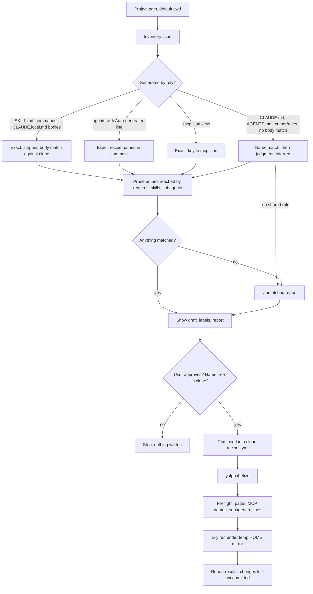

# Phase 8: Project-to-recipe generator skill - Research

**Researched:** 2026-11-04
**Domain:** Ruly recipe loading and squash output, read in reverse by an AI skill
**Confidence:** HIGH (nearly everything was read from source or run in scratch dirs)

<user_constraints>
## User Constraints (from CONTEXT.md)

### Locked Decisions

#### Where the skill lives
- Source file is `ruly/skills/recipe-from-project.md` in the rules repo clone at `~/github.com/patrickclery/rules`. `rules/` in this checkout is empty and gitignored, and `~/.config/ruly/remotes/` is generated and must never be edited.
- It is included through a new small `ruly-tools` recipe in the rules repo's `recipes.yml`. The existing `ruly` recipe is actually a WorkAxle subagent recipe, and `core` is not touched.
- Invocation takes a project path and defaults to the current folder.

#### What counts as "currently used"
- Scan `CLAUDE.md`, `CLAUDE.local.md`, `AGENTS.md`, `.cursor/rules`, `.claude/skills`, `.claude/commands`, `.claude/agents`, and `.mcp.json` (which maps to `mcp_servers:`).
- Match exact first (skill `name:` frontmatter, then content), then use AI judgment for the rest. Label every match in the draft as exact or inferred.
- Content with no shared rule is listed in a report and left out of the recipe. The skill does not create new rule files.
- Ignore `.ruly.yml`: this repo's copy dates from 2025 and does not reflect current state.

#### Output and safety
- Show the draft first, and write only after the user approves it. The target is `recipes.yml` in the rules repo, using repo-relative paths.
- Recipe name defaults to the project folder's name. If that name is taken, the skill asks.
- Validate by running yalphabetize, then `ruly squash <recipe> --dry-run` from a temp directory. Report any failure.
- Leave all changes uncommitted for the user to commit.

### Claude's Discretion
- Internal structure and section wording of the skill file, following the rules repo's standard sections.

### Deferred Ideas (OUT OF SCOPE)
- Creating new shared rule files from unmatched project content.
- A Ruby helper for the mechanical inventory step, only if the skill keeps repeating it.
</user_constraints>

No requirement IDs are mapped. ROADMAP.md lists `**Requirements**: TBD`, so the plan works from the goal and the locked decisions.

## Summary

The decided validation step does not work as written. On this machine a mirror exists, so a plain `ruly squash <recipe> --dry-run` from a temp directory cannot see an uncommitted recipe: it fails with `Recipe 'ruly-tools' not found`, even with a temp `.recipes.yml`. The fix needs no ruly change. Point `HOME` at a temp directory where the clone is symlinked as the mirror. That runs the production code path against the working tree and writes nothing.

Even then, exit 0 proves little. A dry run exits 0 for every missing local path, for an unknown MCP server and for a missing subagent recipe. The skill has to scan the output for the warning strings and run its own preflight on the rest.

Reverse matching is more exact than CONTEXT.md assumed. On two real recipes, all squashed skill, command and rule bodies matched their source byte for byte, and subagent files name their recipe. So nearly all of the matching can be labeled exact, and judgment is only needed for hand-written files. The hard part is pruning: agile produced 6 skills and 4 rule files that its recipe never lists, because they arrive through `requires:` and `skills:` frontmatter.

One gap in the decisions needs an answer. Running `ruly squash ruly-tools` inside a project overwrites its `CLAUDE.local.md` and empties `mcpServers` in `.mcp.json`, which destroys the evidence the skill needs to read. The skill should be generated somewhere else and installed as a personal skill.

**Primary recommendation:** Write one self-contained markdown skill with no `requires:`, install it through a `~/.claude/skills` symlink, match by stripped body first, and validate with the temp-`HOME` mirror script plus an explicit preflight.

### Corrections to CONTEXT.md

| CONTEXT.md says | What actually happens | Evidence |
|-----------------|-----------------------|----------|
| Validate with `ruly squash <recipe> --dry-run` from a temp directory | Cannot see an uncommitted recipe under the real `HOME` | Experiment V0 |
| Lookup order is mirrored remotes, then `./.recipes.yml`, then `~/.config/ruly/recipes.yml` | Correct, but it picks one source for all recipes. Any mirror shuts out `.recipes.yml` entirely | `recipe_loader.rb:147-155` |
| `ruly list-recipes` covers the name-collision check | It reads the mirror, not the clone being written to. Check the clone's keys instead | `recipe_loader.rb:168-176` |
| A pre-commit hook checks the sort order | No hook covers the rules repo, and its `recipes.yml` is currently unsorted | Q6 below |
| `--dry-run` validates a recipe | It misses local paths, MCP names and subagent recipes by exit code | Experiment V3 |
| Draft keys are `description`, `files`, `skills`, `commands`, `subagents`, `mcp_servers` | `omit_command_prefix` is also needed to keep command names | Q5 below, Open Question 3 |
| `CLAUDE.local.md` loses filenames | True, but bodies stay byte-exact and rule-file `name:` frontmatter survives | Experiments A, G |

## Architectural Responsibility Map

This is a CLI and filesystem phase, so the usual web tiers do not apply.

| Capability | Primary Tier | Secondary Tier | Rationale |
|------------|--------------|----------------|-----------|
| Inventory of the project folder | Skill (AI session) | — | Reads files only, and the decision rules out a CLI command |
| Exact matching against the rules repo | Skill, using Bash and Ruby one-liners | Rules repo clone | Mechanical comparison against the working tree |
| Inferred matching | Skill (AI judgment) | — | The reason this is a skill |
| Writing the recipe | Skill, with Edit, after approval | Rules repo `recipes.yml` | A text insert keeps comments |
| Sorting | `yalphabetize` CLI | — | Existing tool |
| Validating | `ruly` CLI under temp `HOME` | Skill's preflight | The dry run has known gaps |
| Distribution to machines | User commit and push, then `ruly squash --sync` | — | The skill leaves changes uncommitted |

## Answers to the Plan's Questions

Experiment labels refer to the [Experiment Log](#experiment-log).

### Q1. How a `skills:` entry becomes `.claude/skills/<name>/SKILL.md`

**The directory name comes from the path, never from frontmatter.** [VERIFIED: lib/ruly/services/script_manager.rb:22-28]

```ruby
if path.include?('/skills/')
  path.split('/skills/').last.sub(/\.md$/, '')
else
  File.basename(path, '.md')
end
```

- `ruly/skills/recipe-from-project.md` produces `.claude/skills/recipe-from-project/SKILL.md`. [VERIFIED: experiment V1]
- Nested paths keep their segments: `x/skills/nested/deep.md` produces `.claude/skills/nested/deep/SKILL.md`, so inventory must glob recursively. [VERIFIED: experiment B]
- The `name:` value can differ from the directory. `x/skills/plainfile.md` with `name: different-name` lands in `.claude/skills/plainfile/`. [VERIFIED: experiment B] Three skills in the rules repo do this: `bug/skills/debugging.md` (`debugging-patterns`), `home/skills/better-display.md` (`better-display-dual-monitor-fix`), `skills/deploy-to-production.md` (`deploying-to-production`). [VERIFIED: skill index run]

**Frontmatter that survives is a fixed list.** [VERIFIED: lib/ruly/services/frontmatter_parser.rb:53]

```ruby
%w[name description permissionMode allowed_tools].each do |key|
```

`model:` is added back for skills only. [VERIFIED: lib/ruly/services/script_manager.rb:425-437]

Experiment A gave a fixture source with `name`, `description`, `argument-hint`, `allowed-tools`, `disable-model-invocation`, `model` and `requires`. The generated file kept only this:

```text
---
model: sonnet
name: recipe-from-project
description: Use when drafting a Ruly recipe from a project folder. Takes $ARGUMENTS as the path.
---
```

Consequences for this skill:

- **Do not use `argument-hint`, `allowed-tools` or `disable-model-invocation`.** They are silently dropped. `allowed_tools` with an underscore survives, but the Claude Code docs name the field `allowed-tools`. [CITED: code.claude.com/docs/en/skills]
- **Keep `description` on one line.** The parser reads a single line with `/^#{key}:\s*(.+)$/`, so a block scalar is destroyed. Experiment B turned `description: >-` plus two lines into `description: >-` followed by the closing `---`. Two existing skills have this defect today: `workaxle/core/skills/code-review.md` and `workaxle/core/skills/bug-diagnosis.md`. That is out of scope here.
- **`$ARGUMENTS` passes through the body untouched.** [VERIFIED: experiment A] The docs say it expands to the full argument string, and arguments are appended as `ARGUMENTS: <value>` when no placeholder receives them. [CITED: code.claude.com/docs/en/skills]
- **A squashed SKILL.md keeps no trace of its source path.** `grep -rn 'ruly/skills\|remotes/patrickclery\|recipe-from-project.md' .` over the output exited 1. [VERIFIED: experiment A] Only the directory name, `name:` and the body can be traced.
- A source with no surviving frontmatter becomes a SKILL.md with none. [VERIFIED: experiment B]
- `requires:` on a skill puts the required file into `CLAUDE.local.md`, not the skill. [VERIFIED: experiment A, script_manager.rb:415-417] Keep this skill self-contained.

### Q2. What passes a dry run, and how to validate an uncommitted recipe

**A recipe needs only to be a key under `recipes:` in the winning source.** Even an entry with no paths exits 0 (`t-empty`). [VERIFIED: experiment V3]

**The source is chosen once, not per recipe.** [VERIFIED: lib/ruly/services/recipe_loader.rb:141-155]

```ruby
mirrored, unmirrored = remotes.partition { |r| RemoteSync.mirrored?(r) }
...
mirrors = mirrored + RemoteSync.undeclared_mirrors(remotes, remotes_dir:)

if mirrors.any?
  @source_origin = :remotes
```

`~/.config/ruly/recipes.yml` declares `- github: patrickclery/rules`, and that mirror exists, so `.recipes.yml` is never read for recipes. [VERIFIED: ~/.config/ruly/recipes.yml:8-9] The clone is not a lookup source at all. Its `recipes.yml` currently matches the mirror's (`diff -q` was silent), and the mirror has no `ruly/` directory yet.

Options tried:

| Approach | Result |
|----------|--------|
| Real `HOME`, temp cwd, temp `.recipes.yml` (V0) | `Recipe 'ruly-tools' not found`, exit 1 |
| Real `HOME`, `.recipes.yml` with `overrides:` (V0b) | `overrides: 'ruly-tools' ... does not match a loaded recipe`, exit 1 |
| **Temp `HOME`, clone symlinked as the mirror (V1)** | **Works, exit 0, origin reads `remote patrickclery/rules`** |
| Temp `HOME`, `.recipes.yml`, `RULY_HOME=<clone>` (V2) | Works, but needs a copied file and takes a different code path |
| Temp `HOME`, `.recipes.yml`, no `RULY_HOME` (V2) | Exit 0 with `0 rule files combined`, a false pass |
| Temp `HOME`, cwd is the clone (V2) | `No recipes found`, since `recipes.yml` is not `.recipes.yml` |

There is no `-r` or recipes-file option on `squash`. [VERIFIED: lib/ruly/cli.rb:37-55]

**Use the temp-`HOME` mirror.** It reads the working tree, so uncommitted edits to `recipes.yml` and to rule files are both visible. Relative paths are rebased exactly as in production. The full script is in [Code Examples](#validate-a-recipe-written-to-the-clone). Against the real clone with `homelab`, under `LC_ALL=C`, it gave:

```text
exit=0
[grep exit=1 (1 = no findings)]
Would create: CLAUDE.local.md
  → 7 rule files combined
```

It also listed 25 `SKILL.md` lines, wrote no files in the temp cwd or temp home, and left `git -C rules status --short` empty. [VERIFIED: experiment exp4]

Things this setup does not apply: the user's `overrides:`, which is correct when validating shared definitions. Do not pass `--sync` or `--deepclean`, and never drop `--dry-run` in this setup.

### Q3. Path resolution and missing files

**Mirror:** relative entries under `files`, `skills`, `commands` and `scripts` are rewritten to absolute mirror paths. [VERIFIED: lib/ruly/services/remote_sync.rb:18, recipe_loader.rb:194-212]

```ruby
RULE_KEYS = %w[files skills commands scripts].freeze
```

`mcp_servers` and `subagents` are not paths and are not rebased.

**Project and user files:** entries stay relative and go through `find_rule_file`, which tries the entry as given (cwd), `File.expand_path`, `~/ruly/<file>`, then `<gem_root>/<file>`. [VERIFIED: recipe_loader.rb:660-673] This is why V2 without `RULY_HOME` finds nothing. Globs are not supported.

**Missing files in a dry run** (the same on the installed 0.1.0 gem and on repo 0.4.0 where tested): [VERIFIED: experiment V3]

| Case | Output | Exit |
|------|--------|------|
| Missing `files:` file or directory | `⚠️  Warning: File not found: <path>` | **0** |
| Missing `skills:` entry | `⚠️  Warning: Skill file not found: <path>` | **0** |
| Missing `commands:` entry | `⚠️  Warning: Command file not found: <path>` | **0** |
| Missing `scripts:` entry | `⚠️  Warning: Script file not found: <path>` | **0** |
| `requires:` target missing | Nothing at all, even with `--strict` | **0** |
| Unknown recipe key | `⚠️  Recipe 't-unknown-key': unknown key 'wibble' is ignored` | **0** |
| Unknown `mcp_servers:` name | Nothing | **0** |
| Unknown `subagents[].recipe` | Nothing | **0** |
| Missing remote URL | `❌ squash failed: 1 required source(s) missing` | **1** |

The cause is that `process_recipe_files` prints the warning and drops the entry, so it never reaches `report_source_failures!`. [VERIFIED: recipe_loader.rb:286-288, cli.rb:231-251] That method's comment says a missing explicit source is an error, so this looks like a ruly bug. Decided scope adds no Ruby, so log it rather than fix it here.

**A bad entry has wider damage later.** `--sync` fetches every explicit path of every recipe and aborts on any miss, so one wrong path in `recipes.yml` blocks `--sync` for all recipes. [VERIFIED: remote_sync.rb:187-200, 249, 372-377] This is why the skill must treat the warnings as failures.

### Q4. `mcp_servers:`

**Source of truth is `~/.config/ruly/mcp.json`, a flat object keyed by server name** (`jq 'has("mcpServers")'` printed `false`). [VERIFIED: lib/ruly/services/mcp_manager.rb:125-146]

At squash time, not in a dry run:

- Names found are copied into `.mcp.json` under `mcpServers`, without `_`-prefixed keys, and with `type: stdio` added when `command` is present.
- Unknown names print `Warning: MCP server 'x' not found in ~/.config/ruly/mcp.json` and are dropped.
- The whole block is replaced: `existing_settings['mcpServers'] = mcp_servers`. Other top-level keys are kept. [VERIFIED: mcp_manager.rb:182, experiment A]

**Mapping is by exact key:** a `.mcp.json` `mcpServers` key maps to a recipe entry of the same name only if it is also a key in `mcp.json`.

`.mcp.json` overstates the recipe. It also holds servers from rule frontmatter and subagent recipes. [VERIFIED: mcp_manager.rb:69-88] Experiment C printed:

```text
🔌 Collected MCP servers from rule files: github
🔌 Propagated MCP servers from subagents: atlassian
```

So the draft should drop names that appear in a matched agent's `mcpServers:` frontmatter or a matched rule's `mcp_servers:` frontmatter. Names missing from `mcp.json` go in the report, because keeping them would only produce a warning.

Read key names only, using `jq -r 'keys[]'` and `jq -r '.mcpServers | keys[]'`. Values can hold tokens. See [Security Domain](#security-domain).

Keys-only output on this machine, for orientation only since the skill reads them live: `Ref`, `atlassian`, `circleci`, `github`, `grafana`, `jetbrains`, `memory`, `permit`, `plane`, `playwright`, `task-master-ai`, `teams`.

### Q5. `.claude/agents/*.md` and commands

**Agent files are fully traceable.** Experiment C produced: [VERIFIED: subagent_processor.rb:354-390, 422-426]

```text
---
name: my_sub
description: A sub recipe
tools: Bash, Read, Write, Edit, Glob, Grep
model: haiku
skills: "[subsk]"
mcpServers: "[atlassian]"
permissionMode: bypassPermissions
# Auto-generated from recipe: sub-recipe
# Do not edit manually - regenerate using 'ruly squash parent'
---
...
*Last generated: 2026-11-04 16:54:12*
*Source recipe: sub-recipe*
```

Mapping to a `subagents:` entry:

| Agent file | Recipe key |
|------------|------------|
| frontmatter `name` | `name` |
| `# Auto-generated from recipe: X` | `recipe: X` |
| frontmatter `model`, unless `inherit` | `model` (`inherit` is the default) |
| `regenerate using 'ruly squash P'` | Not a key. Report: "this project was generated from recipe P" |

The `homelab` fixture shows the real form:

```text
1 # Auto-generated from recipe: linux-sysadmin
1 # Auto-generated from recipe: media-stack
2 # Do not edit manually - regenerate using 'ruly squash homelab'
```

An agent without that line is hand-written, so the skill reports it. Check that recipe `X` exists in the clone, because a missing one is skipped with only a warning at real squash time. [VERIFIED: experiment C] `validate_agent_names!` is the only subagent check in a dry run. [VERIFIED: cli.rb:304-305]

A subagent's skills land in the project's `.claude/skills/` too (`subsk` in experiment C). Subtract the names in each agent's `skills:` from the recipe's own `skills:`.

**Commands map back through content, not path.** The target path is computed from the source path and `omit_command_prefix`. [VERIFIED: script_manager.rb:314-346] Real output for `agile` shows the flattening:

```text
→ orchestrator/spike.md      (from workaxle/orchestrator/commands/spike.md)
→ epic.md                    (from comms/commands/epic.md)
```

Command files keep the same surviving frontmatter as other sources, and 11 of 11 `agile` commands matched by body. [VERIFIED: experiment agile]

When a matched command's project path differs from what the draft would generate, the draft needs `omit_command_prefix`, or a command would change from `/epic` to `/comms:epic`. It is a known recipe key. [VERIFIED: recipe_loader.rb:523-526]

```ruby
commands description extends files hooks isolate mcp_servers model omit_command_prefix remote_sources
scripts skills sources subagents
```

### Q6. yalphabetize on the rules repo

**Exact command, from the clone root:**

```bash
RUBYOPT=-Eutf-8 yalphabetize -a recipes.yml
```

- **`RUBYOPT` is required here.** The Bash tool sets `LC_ALL=C`. Without it, yalphabetize exits 1 with a stack trace and leaves the file unchanged. [VERIFIED: experiment exp3]
- **No `bundle exec`.** The rules repo has no Gemfile, so use the global gem on PATH (0.12.1). [VERIFIED: experiment]
- **Always pass the filename.**
- **No config is needed.** The rules repo has no `.yalphabetize.yml`, and defaults include `'preserve_comments' => true`. [VERIFIED: yalphabetize-0.12.1/lib/yalphabetize.rb:27-33] Copying this repo's config changed nothing (0 diff lines). [VERIFIED: .yalphabetize.yml:1-4, experiment]
- **Comments survive:** 152 comment-bearing lines before and after, and the parsed YAML stayed equal (`semantically_equal=true`). Comments travel with the key below them. [VERIFIED: experiment] Sequences keep their order, so `files:` concatenation order is safe. [VERIFIED: experiment]

**The file is not sorted today.** `yalphabetize recipes.yml` exits 1. The inversions are `core-solo > core-debugger`, `linux-sysadmin > homelab` and `portfolio > playwright`. [VERIFIED: experiment]

This is because no hook covers it. The only pre-commit config is in this repo's lefthook: [VERIFIED: lefthook.yml:17-20]

```yaml
yalphabetize:
  glob: "recipes.yml"
  run: RUBYOPT="-Eutf-8" bundle exec yalphabetize -a {staged_files}
```

This repo has no `recipes.yml` for that glob to catch. The rules repo has no non-sample hooks in `.git/hooks`, and its global `core.hooksPath` directory has no pre-commit hook and no mention of yalphabetize.

**So the first run produces a noisy diff:** 317 changed lines, of which 4 are the new recipe. It moves those three recipes and a few `isolate` keys, adds a trailing space to 4 empty `mcp_servers:` lines, and removes one blank line. Once sorted, adding `ruly-tools` is a clean 4-line hunk placed right after `ruly`, and a second run is a no-op. [VERIFIED: experiment] Commit one pre-sort in this phase (Open Question 4).

**`feedback_recipes_yml_yalphabetize.md` is out of date, and part of it is unsafe.** It cites `cd /Users/patrick/Projects/ruly`, `bundle exec` and `cp recipes.yml ~/.config/ruly/recipes.yml`. That last step would overwrite the machine config, which now holds only `remotes:` and `overrides:`. Do not copy it into the skill.

**Never round-trip the file through a YAML library.** Insert text with Edit, then sort. An insert directly under `recipes:` works because yalphabetize moves it. [VERIFIED: experiment exp3]

### Q7. Skill-authoring constraints

**Frontmatter:** `name` and `description` only, on one line each. The rules repo's format is: [VERIFIED: home/skills/update-rules.md:30-37]

> Every file has `name` and `description` frontmatter, then these sections as needed: Description, Key Patterns, Examples, Best Practices, Anti-patterns, Related Files.

**The filename rule applies to rule sources, not real outputs.** The update-rules skill already names `recipes.yml`, `CLAUDE.local.md` and `.claude/skills/*/SKILL.md` freely, because those exist on disk after a squash. This skill may do the same. It must not refer to other rule source files or to slash commands, including its own. Its `description` should describe triggers in words.

**`recipe-from-project` needs no section links.** With no `requires:` there is nothing to link to, and no anchors can go stale.

**Post-squash checks cannot trip on this skill** as designed: [VERIFIED: lib/ruly/checks.rb:13-26, checks/ambiguous_links.rb, checks/duplicate_skill_requires.rb]

| Check | Runs on | Effect here |
|-------|---------|-------------|
| `AmbiguousLinks` | `local_sources` and `command_files` for the claude target; skills also for `-a agents` (`cli.rb:408`) | Only flags `[x](#anchor)` links to duplicated headings. No anchor links, no finding |
| `DuplicateSkillRequires` | Skills | Needs a file required by 2 or more skills. No `requires:`, so inert |
| `validate_squash_dispatches` | Sources with `dispatches:` | Raises if unregistered. Do not use `dispatches:` |

All of these except the dispatch check run in `post_squash`, which a dry run skips, so a dry run never exercises them. [VERIFIED: cli.rb:85-90, 413-441]

`require_shell_commands:` only warns when a command is missing and does not fail. [VERIFIED: shell_command_checker.rb:54-62] It would fit `ruly`, `yalphabetize` and `jq`, but it adds nothing the skill's own failed commands would not show. Leave it out.

The rules repo's own CLAUDE.md asks that edits go through a GSD workflow, which this phase is.

### Q8. Docs and the `core` rule

**No README or CLAUDE.md change is required in this repo.** The README rules trigger on slash commands and `ruly` CLI commands, and neither changes. [VERIFIED: CLAUDE.md, this repo] The README's skills material documents the recipe key generically, and no individual rules-repo skill is listed. No gem change means no version bump or CHANGELOG entry, and no reinstall is triggered by this phase.

**The `core` `--deepclean` rule is not triggered.** No `core` entry references `ruly/`, the output was `core refs ruly dir? []`, and the pre-sort leaves `core` parsed-equal. [VERIFIED: skill index run, semantic check] Its command could not run here anyway, because `~/agents/core` does not exist on this machine (`~/agents` holds `local`, `qa`, `workaxle`).

## Standard Stack

No packages are installed. The skill uses tools already present.

| Tool | Version | Purpose | Why |
|------|---------|---------|-----|
| `ruly` on PATH | 0.1.0 installed, 0.4.0 in the repo | Dry-run validation | Identical behavior for everything the skill uses (V1b, V1c, V3) |
| `yalphabetize` | 0.12.1 | Sort `recipes.yml` | Existing convention, keeps comments |
| `ruby -Eutf-8 -ryaml` | 4.0.1 | Read recipe keys | Already a ruly dependency |
| `jq` | 1.8.2 | Key names from JSON | Avoids reading secret values |

[VERIFIED: lib/ruly/version.rb:4 `VERSION = '0.4.0'`; `ruly version` printed `Ruly v0.1.0`]

The installed gem has no `-a claude-plugin` target. It accepted the flag and wrote a normal squash. [VERIFIED: experiment E] STATE.md already lists the stale binary as a blocker.

**Installation:** none for the skill's tooling.

## Package Legitimacy Audit

Not applicable. This phase installs no external packages.

**Packages removed due to [SLOP] verdict:** none
**Packages flagged as suspicious [SUS]:** none

## Architecture Patterns

### System Architecture Diagram



### Recommended File Layout

```text
~/github.com/patrickclery/rules/
├── recipes.yml                          # gains ruly-tools
└── ruly/
    └── skills/
        └── recipe-from-project.md       # name + description, then standard sections
```

Nothing else in the rules repo changes, and nothing in `lib/` of this repo changes.

### Pattern 1: Exact matching order

**Build the index from the clone, not the mirror**, over `**/*.md`, excluding `.git` and `.planning`. Store each file's `name:` and its stripped body.

| Project artifact | Exact signal | Fallback |
|------------------|--------------|----------|
| `.claude/skills/**/SKILL.md` | Stripped body equals a source body | `name:`, then directory against the derived name, then judgment |
| `.claude/commands/**/*.md` | Stripped body equals a source body | Judgment |
| `CLAUDE.local.md` | Source body is a substring. `name: x` lines also survive | Heading comparison, inferred |
| `.claude/agents/*.md` | `# Auto-generated from recipe: X` | Hand-written, report |
| `.mcp.json` | Key in `~/.config/ruly/mcp.json` | Report |
| `AGENTS.md` | Line 1 `<!-- Generated by ruly from recipe: NAME — do not edit -->`, and rule bodies | Judgment. Skills there have demoted headings, so body match fails for them [VERIFIED: agents_md.rb:49-53, 105-112] |
| `CLAUDE.md`, `.cursor/rules` | None: ruly never writes these on the default path | Judgment only |

CONTEXT.md puts `name:` ahead of content. Body match should run first for generated files, since it identifies the file itself, while a `name:` match can survive an edited body. Both count as exact.

**Evidence that this holds on real data:**

| Fixture | Skills | Rule files | Commands |
|---------|--------|------------|----------|
| `homelab` (real, read-only) | 25/25 body-exact | 7/7 substring | none |
| `agile` (squashed in scratch) | 6/6 body-exact | 15/15 substring | 11/11 body-exact |
| `startup` (squashed in scratch) | — | 9/9 substring | — |

[VERIFIED: experiments G, exp3, agile]

Scripts can reduce exactness. `write_sources` rewrites script references in `CLAUDE.local.md`, and `--toc` adds anchors. [VERIFIED: squash_helpers.rb:133-140] Neither hit the fixtures above, but 4 rule files in the repo declare `scripts:`. A miss there falls back to inferred, which is safe.

**Generated by other tools:** a `gsd-*` skill or a skill folder with extra files will not match anything. Report it as not from the rules repo.

### Pattern 2: Prune to the roots

`agile`'s recipe has no `skills:` key, yet its squash writes 6 skills, and 4 unlisted rule files appear in `CLAUDE.local.md`: `comms/commands/context-fetching.md`, `comms/ticket-summary-template.md`, `workaxle/commands.md`, `workaxle/health-checks-common.md`. [VERIFIED: experiment agile]

After matching, drop any entry reachable from another matched entry through `requires:` or frontmatter `skills:`. Listing them anyway is harmless, since sources de-duplicate by realpath, [VERIFIED: source_processor.rb:141-153] but it makes the draft noisy and it stops tracking the source file's dependencies.

Also drop entries owned by a subagent recipe, and never add a subagent's rule files to `files:`.

### Pattern 3: Stop when nothing matches

This repo is the user's named test case, and nothing in it matches:

- `.claude/commands/add-core-subagent.md`, `ruly/compress.md`, `ruly/decompose.md`: no exact match. [VERIFIED: experiment exp4]
- `CLAUDE.md`: no rule body found. Generic headings overlap (`Conventions`, `Error Handling`, `Architecture`), and those should not count as matches.
- `.mcp.json`, `CLAUDE.local.md`, `AGENTS.md`, `.cursor/rules`, `.claude/agents`, `.claude/skills`: absent.
- `.claude/ruly/skills/command-to-subagent/SKILL.md` is outside the decided scan list.
- The default name `ruly` is taken.

An empty recipe passes the dry run (`t-empty`), so the skill must check for this itself: report and write nothing. Use `homelab` as the second fixture, because it exercises every exact path.

### Anti-Patterns to Avoid

- **Trusting the dry run's exit code:** see Q3.
- **Running `ruly squash` in the scanned project:** it overwrites the evidence. See Pitfall 1.
- **Using `ruly list-recipes` for the collision check:** it reads the mirror.
- **Treating generic heading overlap as a match:** the standard headings are shared across the repo.
- **Writing a `# inferred` comment into `recipes.yml`:** show labels in the draft instead. They would outlive the review and read as fact.

## Don't Hand-Roll

| Problem | Don't Build | Use Instead | Why |
|---------|-------------|-------------|-----|
| Sorting YAML | Manual placement | `yalphabetize` | Keeps comments and handles key order |
| Loading recipes | A custom loader | Temp-`HOME` mirror | Same rebasing as production |
| Frontmatter stripping | A new regex | `s.split(/^---\s*$/, 3)[2]`, as in `strip_metadata` | Must match how output was generated |
| Inventory tool in Ruby | A helper script | Inline one-liners | Deferred by decision |

**Key insight:** every comparison must use ruly's own rules for what it strips and how it names things, or exact matches turn into false misses.

## Common Pitfalls

### Pitfall 1: Installing the skill destroys what it reads
**What goes wrong:** `ruly squash ruly-tools` in a project replaces `CLAUDE.local.md` and empties `mcpServers`.
**Why it happens:** a recipe owns those outputs. Experiment A went from existing content to this, with `-o` protecting only the markdown (experiment F):
```text
{
  "mcpServers": {},
  "other": 1
}
```
**How to avoid:** generate `ruly-tools` in its own directory and symlink it into `~/.claude/skills/` (Open Question 1).
**Warning signs:** an empty `CLAUDE.local.md` in a project that has `.claude/skills/recipe-from-project/`. The skill should warn when it sees this.

### Pitfall 2: A false pass from the dry run
**What goes wrong:** a path is wrong, the exit code is 0, and `--sync` later breaks for every recipe.
**How to avoid:** grep the output and run the preflight. See [Code Examples](#validate-a-recipe-written-to-the-clone).
**Warning signs:** `0 rule files combined` on a recipe that should have some.

### Pitfall 3: `Required shell command ... not found in PATH` looks like a failure
**What goes wrong:** a naive `grep 'not found'` fails `agile` on `post-jira-comment.sh` and `markdown-to-adf.mjs`, which are scripts ruly copies later.
**How to avoid:** match `[Ff]ile not found`. Report the shell command warning as information.

### Pitfall 4: First-run diff noise
**What goes wrong:** 317 changed lines hide a 4-line recipe from the user reviewing it.
**How to avoid:** pre-sort once in this phase, in its own commit.

### Pitfall 5: The squash to adopt the new recipe rewrites project state
**What goes wrong:** after approval the user runs `ruly squash <recipe> --sync` in the project. Any server not in the draft leaves `.mcp.json`, and hand-edits to `CLAUDE.local.md` are lost. Stale skills stay, since a squash without `--clean` does not remove them (`.claude/skills/old` survived experiment A).
**How to avoid:** the final report should list what will be lost: unmatched MCP servers and any unmatched content in `CLAUDE.local.md`.

### Pitfall 6: Comparing against the mirror
**What goes wrong:** the mirror lags the clone, so a match can point at an older body or miss a new file.
**How to avoid:** index the clone. Also fail clearly if the clone is missing on a machine.

## Code Examples

### Validate a recipe written to the clone

Run from anywhere. Tested on the real clone with `homelab`, and against a scratch clone with `ruly-tools` (V1, exp4).

```bash
RULES=~/github.com/patrickclery/rules
RECIPE=<recipe-name>
VAL=$(mktemp -d)
mkdir -p "$VAL/home/.config/ruly/remotes/patrickclery" "$VAL/cwd"
ln -s "$RULES" "$VAL/home/.config/ruly/remotes/patrickclery/rules"

( cd "$VAL/cwd" && HOME="$VAL/home" ruly squash "$RECIPE" --dry-run > "$VAL/out.txt" 2>&1 )
echo "exit=$?"
cat "$VAL/out.txt"

# Any line here is a failure, even with exit=0.
grep -E '[Ff]ile not found|No markdown files|unknown key|Failed to fetch|squash failed' "$VAL/out.txt"

rm -rf "$VAL"   # removes the symlink, not the clone
```

Failure strings are from `recipe_loader.rb:281,287,330,355,544`, `source_processor.rb:332` and `cli.rb:248`.

Under a temp `HOME`, `gh` has no config. A public URL entry still fetched in experiment D. Add `GH_CONFIG_DIR=~/.config/gh` before `HOME=` if a draft ever includes a private URL. (Expand `~` first, since `HOME` changes on that command.)

### Preflight the checks a dry run skips

```bash
cd ~/github.com/patrickclery/rules

# Existing recipe names: use for the collision check and for subagents[].recipe.
ruby -Eutf-8 -ryaml -e 'puts YAML.safe_load_file(ARGV[0], aliases: true)["recipes"].keys' recipes.yml

# Valid mcp_servers names (keys only).
jq -r 'keys[]' ~/.config/ruly/mcp.json

# Every local path in the draft must exist: test -e "<entry>" from the clone root.
```

[VERIFIED: both commands run in exp4 under `LC_ALL=C`]

### Stripped-body comparison

```ruby
# Run with ruby -Eutf-8. Mirrors FrontmatterParser.strip_metadata's split.
body = ->(s) { s.start_with?('---') ? (s.split(/^---\s*$/, 3)[2] || s) : s }

# SKILL.md or command file: equality.
body.call(File.read(generated)).strip == body.call(File.read(source)).strip
# CLAUDE.local.md: substring.
File.read('CLAUDE.local.md').include?(body.call(File.read(source)).strip)
```

This exact logic gave the coverage figures in Pattern 1. Skip very short bodies for the substring test, since exp3 and exp4 used a 200-character floor when looking for unlisted files.

### The recipe entry

```yaml
  ruly-tools:
    description: "Ruly authoring tools"
    skills:
      - ruly/skills/recipe-from-project.md
```

[VERIFIED: experiment V1 with this exact entry and path; the skill name and recipe name are from CONTEXT.md] A fuller description is fine. With no `files:` the squash writes an empty `CLAUDE.local.md`, so the skill file must have no `requires:`.

### Skill frontmatter

```yaml
---
name: recipe-from-project
description: <one line, triggers in words, under 1536 characters>
---
```

The 1,536-character figure is the listing cap for `description` plus `when_to_use`. [CITED: code.claude.com/docs/en/skills] Read the project path from `$ARGUMENTS`, defaulting to the current directory.

## State of the Art

| Old Approach | Current Approach | When Changed | Impact |
|--------------|------------------|--------------|--------|
| `recipes.yml` in this repo, copied to `~/.config/ruly/` | Rules repo `recipes.yml`, mirrored by `--sync` | Before this phase (`~/.config/ruly/recipes.yml` is dated 2026-10-05) | The memory's `cp` step is now harmful |
| `rules/` submodule in this checkout | Separate clone, gitignored `rules/` | Same period | CLAUDE.md's two-repo commit wording no longer maps directly |

**Deprecated/outdated:** `feedback_recipes_yml_yalphabetize.md` (see Q6). The commit guidance in CLAUDE.md that refers to a `rules` submodule.

## Assumptions Log

| # | Claim | Section | Risk if Wrong |
|---|-------|---------|---------------|
| A1 | `ruly-tools` should be generated in its own directory and symlinked into `~/.claude/skills/` [ASSUMED] | Open Question 1 | The user wants another delivery. Small rework, no code impact |
| A2 | A pre-sort commit is acceptable to the user [ASSUMED] | Pitfall 4 | Without it, the first draft's diff is noisy |
| A3 | `$ARGUMENTS` and the symlinked skill load correctly in Claude Code. Docs say so, but this session did not invoke the skill [CITED, not exercised] | Q1, Open Question 1 | Caught in the first manual run |
| A4 | `omit_command_prefix` may be added beyond the keys CONTEXT.md lists [ASSUMED] | Q5 | Without it, generated command names can change |

## Open Questions

1. **How does the skill reach a session?**
   - What we know: squashing `ruly-tools` in a project damages that project (Pitfall 1). `~/.claude/skills/creator-takes` is already a symlink to generated output in homelab, and the docs allow symlinked skill folders. [CITED: code.claude.com/docs/en/skills] It is not chezmoi-managed (`chezmoi: ... not managed`).
   - What's unclear: CONTEXT.md decides the recipe but not the install.
   - Recommendation: `mkdir -p ~/agents/ruly-tools && cd ~/agents/ruly-tools && ruly squash ruly-tools --sync`, then `ln -s ~/agents/ruly-tools/.claude/skills/recipe-from-project ~/.claude/skills/recipe-from-project`. That makes "defaults to the current folder" work everywhere. The `claude-plugin` target also avoids project writes (experiment E) but requires reinstalling the gem and adds a rules skill. Confirm with the user. The MacBook needs the same steps.

2. **Does this phase commit and push in the rules repo?**
   - What we know: "Leave all changes uncommitted" describes the skill's runtime behavior. The skill file itself must be pushed before `--sync` can install it, as the update-rules skill notes.
   - Recommendation: the plan commits named paths with `git -C ~/github.com/patrickclery/rules`, never `git add -A`, and asks before pushing.

3. **Is `omit_command_prefix` allowed in a draft?**
   - What we know: it is not in the listed keys, and without it command names can change.
   - Recommendation: include it only when needed to reproduce a matched command's existing path, and label it in the draft.

4. **Pre-sort now?**
   - Recommendation: yes, as its own commit before adding `ruly-tools`.

5. **Should the ruly exit-code gaps be fixed?**
   - What we know: `report_source_failures!` documents behavior that local paths do not get, and `--strict` misses `requires:` targets.
   - Recommendation: leave them out of this phase, which adds no Ruby, and capture them as a follow-up. The skill's grep and preflight still work if they are fixed later.

## Environment Availability

| Dependency | Required By | Available | Version | Fallback |
|------------|-------------|-----------|---------|----------|
| Rules repo clone | Index and write target | ✓ | `c123968`, clean, level with `origin/main` | None, blocking if absent |
| `ruly` | Validation | ✓ | 0.1.0 (stale against repo 0.4.0) | `bin/ruly` from this repo |
| `yalphabetize` | Sorting | ✓ | 0.12.1 | None needed |
| `ruby` | YAML key read | ✓ | 4.0.1 | — |
| `jq` | JSON key read | ✓ | 1.8.2 | Ruby JSON |
| `gh` | Remote URL entries, `--sync` | ✓ | 2.102.0 | `git clone` fallback in `--sync` |

Under temp `HOME`, `ruly` still loads, and no `GEM_PATH` is needed, because the gem is also in the mise install's gem dir. [VERIFIED: exp3 listed `ruly-0.1.0` in both gem dirs, `HOME=$H ruly version` printed `Ruly v0.1.0`]

**Missing dependencies with no fallback:** none.

## Verification Fixtures

`workflow.nyquist_validation` is `false`, so the Validation Architecture section is omitted. These manual checks still suit a markdown skill. Run them from a scratch copy so the rules repo is not modified, or discard the result.

| Fixture | Expected |
|---------|----------|
| This repo | No matches, nothing written, report lists the 3 commands and `CLAUDE.md`, name `ruly` flagged as taken |
| `~/github.com/patrickclery/homelab` (read-only) | 25 skills, 7 files and 2 subagents, all exact. Reported as generated from `homelab`. Name flagged as taken |
| Scratch squash of `agile` | The 6 frontmatter skills and 4 `requires:` files are pruned, and `omit_command_prefix` is offered |
| Draft with a bad path | Grep finds it despite exit 0, and the failure is reported |
| Draft with an unknown MCP name or subagent recipe | Preflight reports it |
| Validation run | `git status` shows only `recipes.yml`, and no commit is made |

## Security Domain

`security_enforcement` is absent from config, so it is treated as enabled.

### Applicable ASVS Categories

| ASVS Category | Applies | Standard Control |
|---------------|---------|------------------|
| V2 Authentication | no | — |
| V3 Session Management | no | — |
| V4 Access Control | no | Local user's own files |
| V5 Input Validation | yes | Project files are treated as data. Recipe names and paths are checked before writing |
| V6 Cryptography | no | — |
| V8 Data Protection (secrets) | yes | `jq` key names only, never values |

### Known Threat Patterns

| Pattern | STRIDE | Standard Mitigation |
|---------|--------|---------------------|
| Instructions embedded in a scanned `CLAUDE.md` or SKILL.md | Tampering, Elevation | The skill states that scanned content is data. Writing requires approval of a displayed draft |
| Tokens from `.mcp.json` or `mcp.json` reaching the report, transcript or public `recipes.yml` | Information Disclosure | Read keys only. The rules repo is on GitHub, and the update-rules skill already forbids secrets there |
| A draft entry pointing outside the rules repo | Tampering | Repo-relative paths only, and each path must exist inside the clone. Absolute, `~` and `..` entries are refused |
| A recipe name breaking YAML or the shell | Tampering | Quote in shell. Ask the user if the folder name has anything outside `[A-Za-z0-9._-]` |
| Destructive squash in the scanned project | Tampering | The skill never runs a non-dry squash, and only runs from temp dirs |

## Project Constraints (from CLAUDE.md)

- Shared recipes live in `recipes.yml` in the rules repo with repo-relative paths. `~/.config/ruly/remotes/` is generated and never edited.
- Skills are plain `.md` files at `{tag}/skills/{skill-name}.md`, not `SKILL.md`.
- Never reference filenames of rule sources or slash command names in rules. Use anchors plus `requires:`.
- Use `git mv` for moves. Search for references when moving or deleting rule files.
- Test `ruly squash` from a temp dir, never the main project directory.
- Recipes have no glob support. List explicit files or directories.
- Use Mermaid for diagrams in rules.
- Never edit `CLAUDE.local.md`.
- After `core` recipe changes, run the `--deepclean` command. Not triggered here (Q8).
- Update the README only for slash command or `ruly` CLI changes. Not triggered here (Q8).
- Edit dotfiles through chezmoi. `~/.claude/skills/creator-takes` is not managed, so a plain symlink matches current practice.
- From memory: one mechanism per need, with no unrequested flags or config sources. This is why the plan has one validation route and adds no ruly options.

## Experiment Log

All runs were in `mktemp -d` dirs under the session scratchpad. The rules repo clone and `~/.config/ruly/` were read only. `git -C rules status --short` stayed empty, and `ruly stats` was never run. `$E` is the scratch root, `$C` a scratch copy of the clone with a fixture skill and the `ruly-tools` entry added, and `$H` a temp home holding `$C` at `.config/ruly/remotes/patrickclery/rules`.

| ID | Command (from a temp cwd) | Result |
|----|---------------------------|--------|
| V0 | `cp $C/recipes.yml .recipes.yml; ruly squash ruly-tools --dry-run` | `Recipe 'ruly-tools' not found`, exit 1 on both binaries |
| V0b | `.recipes.yml` with `overrides: ruly-tools`, repo `bin/ruly squash ruly-tools --dry-run` | `does not match a loaded recipe`, exit 1 |
| V1 | `HOME=$H ruly squash ruly-tools --dry-run` | `→ .claude/skills/recipe-from-project/SKILL.md`, exit 0 |
| V1c | Same with repo `bin/ruly`; `list-recipes` | Same result; `📍 remote patrickclery/rules` |
| V2 | `HOME=$H2 RULY_HOME=$C bin/ruly squash ruly-tools --dry-run` | Exit 0, but `0 rule files` without `RULY_HOME` |
| V3 | `HOME=$H3 bin/ruly squash t-* --dry-run`, plus `--strict` | Table in Q3 |
| A | `HOME=$H bin/ruly squash ruly-tools` in a project with existing files | `CLAUDE.local.md` replaced, `mcpServers` emptied, frontmatter as in Q1 |
| B | Squash of fixture skills | Directory from path, block scalar broken |
| C | Squash of a fixture parent recipe with a subagent, and the same with `--dry-run` | Agent file as in Q5. The dry run reports no subagent or MCP problem |
| D | `d` recipe with GitHub URLs, with and without `GH_CONFIG_DIR` | Missing URL gives exit 1. Public URL fetched in both |
| E | `bin/ruly squash ruly-tools -a claude-plugin -o $E/plug` | Plugin written, project files untouched. The 0.1.0 gem does not support this |
| F | `HOME=$H bin/ruly squash ruly-tools -o $E/throwaway.md` | `CLAUDE.local.md` kept, `mcpServers` still emptied |
| G | `HOME=$H bin/ruly squash startup` | Agent format, 9/9 rule bodies are exact substrings |
| agile | `HOME=$H ruly squash agile` | Rule files 15/15, commands 11/11, skills 6/6, plus 4 unlisted rule files |
| exp3 | Yalphabetize runs on scratch copies, and `homelab` compared read-only | Q6 and Pattern 1 |
| exp4 | Recommended script against the real clone, `homelab`, `LC_ALL=C` | Exit 0, no findings, no files written |

## Sources

### Primary (HIGH confidence)
- This repo, read this session: `lib/ruly/cli.rb`, `services/recipe_loader.rb`, `remote_sync.rb`, `script_manager.rb`, `subagent_processor.rb`, `source_processor.rb`, `frontmatter_parser.rb`, `mcp_manager.rb`, `squash_helpers.rb`, `agents_md.rb`, `settings_manager.rb`, `shell_command_checker.rb`, `dependency_resolver.rb`, `display.rb`, `checks.rb`, `checks/ambiguous_links.rb`, `checks/duplicate_skill_requires.rb`, `lefthook.yml`, `.yalphabetize.yml`
- Rules repo: `recipes.yml`, `home/skills/update-rules.md`, `CLAUDE.md`
- `yalphabetize-0.12.1/lib/yalphabetize.rb`
- The experiments above

### Secondary (MEDIUM confidence)
None.

### Tertiary (LOW by the classify-confidence seam, official but not exercised)
- <https://code.claude.com/docs/en/skills>: frontmatter fields, `$ARGUMENTS`, symlinked folders, description cap. Read to about 100,000 of 118,986 characters.

## Metadata

**Confidence breakdown:**
- Recipe loading and validation: HIGH, read from source and run
- Reverse matching: HIGH, measured on 3 real recipes
- Claude Code loading behavior: LOW to MEDIUM, from official docs and not exercised
- Install path: MEDIUM, reasoned from precedent and pending confirmation

**Research date:** 2026-11-04
**Valid until:** 2026-12-04, or sooner if ruly's loader or `--dry-run` changes
