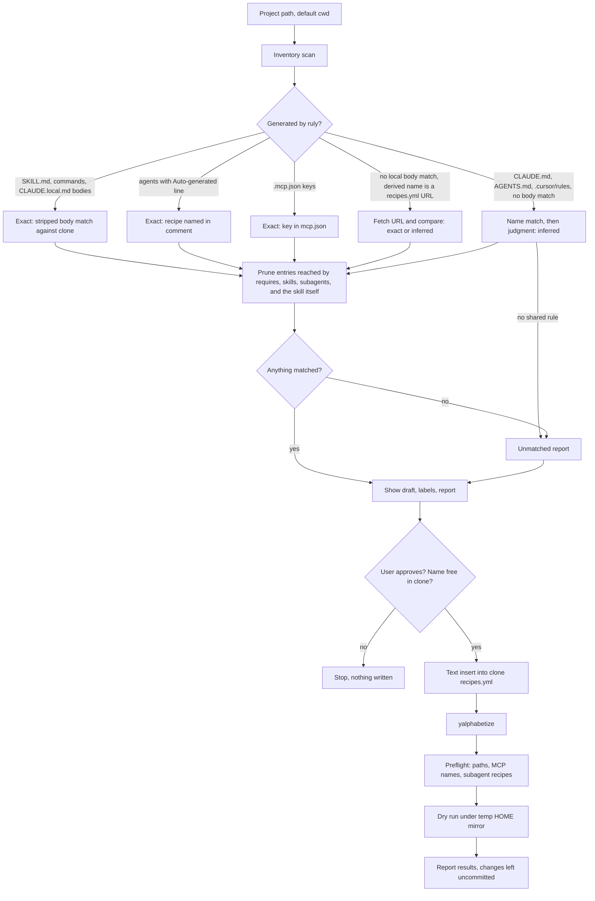

# Phase 8: Project-to-recipe generator skill - Research

**Researched:** 2026-11-04
**Domain:** Ruly recipe loading and squash output, read in reverse by an AI skill
**Confidence:** HIGH (nearly everything was read from source or run in scratch dirs)

<user_constraints>
## User Constraints (from CONTEXT.md)

### Locked Decisions

#### Where the skill lives
- Source file is `skills/recipe-from-project.md` at the root of THIS repo (patrickclery/ruly), tracked in git. This replaces the earlier rules-repo location by the user's explicit decision after research: "This skill would be located in a markdown file inside of this repo. When ruly is run, you can just reference the remote repo version of the file and it will fetch it from there when squash is run."
- Recipes reference it by GitHub URL (`https://github.com/patrickclery/ruly/blob/main/skills/recipe-from-project.md`), and squash fetches it. No `~/.claude/skills` symlink and no separate generated install directory.
- It is included through a new small `ruly-tools` recipe in the rules repo's `recipes.yml`, whose `skills:` entry is that URL. The existing `ruly` recipe is actually a WorkAxle subagent recipe, and `core` is not touched.
- Squashing `ruly-tools` inside a target project overwrites that project's `CLAUDE.local.md` and empties `mcpServers` in `.mcp.json`, which destroys the evidence the skill reads. The skill warns when it detects that state, and its docs say to add the URL to the project's existing recipe or run from another directory with a path.
- Invocation takes a project path and defaults to the current folder.
- The URL only resolves after this repo's commit is pushed to `main`, so end-to-end verification waits on the push approval below.

#### What counts as "currently used"
- Scan `CLAUDE.md`, `CLAUDE.local.md`, `AGENTS.md`, `.cursor/rules`, `.claude/skills`, `.claude/commands`, `.claude/agents`, and `.mcp.json` (which maps to `mcp_servers:`).
- Match exact first (skill `name:` frontmatter, then content), then use AI judgment for the rest. Label every match in the draft as exact or inferred.
- Content with no shared rule is listed in a report and left out of the recipe. The skill does not create new rule files.
- Ignore `.ruly.yml`: this repo's copy dates from 2025 and does not reflect current state.

#### Output and safety
- Show the draft first, and write only after the user approves it. The target is `recipes.yml` in the rules repo, using repo-relative paths.
- Recipe name defaults to the project folder's name. If that name is taken, the skill asks.
- Validate by running `RUBYOPT=-Eutf-8 yalphabetize -a recipes.yml`, then `ruly squash <recipe> --dry-run` from a temp directory under a temp `HOME` that symlinks the rules clone as the mirror (a plain dry run cannot see an uncommitted recipe; see 08-RESEARCH.md). Also grep the output for failure strings and preflight local paths, MCP names and subagent recipes, because exit 0 proves little. Report any failure.
- At runtime, the skill leaves all changes uncommitted for the user to commit.
- Drafts may use `omit_command_prefix`, only when needed to keep a project's current command names, and it is labelled in the draft.

#### Building this phase
- In the rules repo, `recipes.yml` gets its own sort commit first, then a separate commit adding `ruly-tools`. Commit named paths only, never `git add -A`.
- Ask the user before pushing either repo. The user approved commits in the rules repo and asked to be asked before pushing.

### Claude's Discretion
- Internal structure and section wording of the skill file, following the rules repo's standard sections.

### Deferred Ideas (OUT OF SCOPE)
- Creating new shared rule files from unmatched project content.
- A Ruby helper for the mechanical inventory step, only if the skill keeps repeating it.
</user_constraints>

No requirement IDs are mapped. ROADMAP.md lists `**Requirements**: TBD`, so the plan works from the goal and the locked decisions.

## Summary

*Updated after decision commit 6087bdb moved the skill to this repo. Earlier findings still hold unless changed here, and Q9 to Q13 cover the URL-sourced design.*

The URL design works with no ruly change. Squash treats a `skills:` URL like any other skill, the mirror never copies it, and `--sync` ignores it, so a URL that does not exist yet cannot abort `--sync` for other recipes. Nothing caches the fetch, so each squash takes the current file from `main`. A project's generated copy only changes when that project is squashed again.

Until the skill reaches `main`, the temp-`HOME` validation script gives exit 1 and its grep reports `Failed to fetch` for that URL. That is the expected pending state. Everything except the fetch can be verified before the push by using a local absolute path in a scratch recipe. Pushing alone is not enough: this checkout is on `gsd/phase-06-subscription-only`, and the URL needs the file on `main`.

A plain `ruly squash <recipe> --dry-run` from a temp directory cannot see an uncommitted recipe, because a mirror exists: it fails with `Recipe 'ruly-tools' not found`, even with a temp `.recipes.yml`. The decided fix needs no ruly change. Point `HOME` at a temp directory where the clone is symlinked as the mirror. That runs the production code path against the working tree and writes nothing.

Even then, exit 0 proves little. A dry run exits 0 for every missing local path, for an unknown MCP server and for a missing subagent recipe. The skill has to scan the output for the warning strings and run its own preflight on the rest.

Reverse matching is more exact than CONTEXT.md assumed. On two real recipes, all squashed skill, command and rule bodies matched their source byte for byte, and subagent files name their recipe. So nearly all of the matching can be labeled exact, and judgment is only needed for hand-written files. The hard part is pruning: agile produced 6 skills and 4 rule files that its recipe never lists, because they arrive through `requires:` and `skills:` frontmatter.

Two ways of using the skill avoid destroying the evidence, and the squash output of both was tested. For a project built from a recipe, add the URL to that recipe, directly or through `overrides:`. The only difference from a fresh squash of that recipe was the new skill directory. For any other project, squash `ruly-tools` in an empty directory and pass the project path. See Q12.

**Primary recommendation:** Write one self-contained markdown skill at `skills/recipe-from-project.md` with no `requires:`, reference it by URL, match by stripped body first, and validate with the temp-`HOME` mirror script plus an explicit preflight.

### Corrections to CONTEXT.md

| CONTEXT.md says | What actually happens | Evidence |
|-----------------|-----------------------|----------|
| The URL resolves after a push to `main` | Correct, but this checkout is on a feature branch, so it needs a merge too. A branch URL with `/` in its name cannot stand in, because the parser reads `gsd` as the branch | X10, `github_client.rb:203` |
| The target is `recipes.yml`, using repo-relative paths | URL entries are the exception. A matched URL entry must be copied verbatim | Q13 |
| Lookup order is mirrored remotes, then `./.recipes.yml`, then `~/.config/ruly/recipes.yml` | Correct, but it picks one source for all recipes. Any mirror shuts out the `recipes:` key of `.recipes.yml`. Its `overrides:` still apply | `recipe_loader.rb:147-155`, X8 |
| `ruly list-recipes` covers the name-collision check | It reads the mirror, not the clone being written to. Check the clone's keys instead | `recipe_loader.rb:168-176` |
| A pre-commit hook checks the sort order | No hook covers the rules repo, and its `recipes.yml` is currently unsorted | Q6 below |
| `CLAUDE.local.md` loses filenames | True, but bodies stay byte-exact and rule-file `name:` frontmatter survives | Experiments A, G |

## Architectural Responsibility Map

This is a CLI and filesystem phase, so the usual web tiers do not apply.

| Capability | Primary Tier | Secondary Tier | Rationale |
|------------|--------------|----------------|-----------|
| Inventory of the project folder | Skill (AI session) | — | Reads files only, and the decision rules out a CLI command |
| Delivering the skill file | GitHub (`main` of this repo), fetched by squash | Rules repo `ruly-tools` recipe | Decided: no local install |
| Exact matching against the rules repo | Skill, using Bash and Ruby one-liners | Rules repo clone, plus fetches for URL entries | Mechanical comparison against the working tree |
| Inferred matching | Skill (AI judgment) | — | The reason this is a skill |
| Writing the recipe | Skill, with Edit, after approval | Rules repo `recipes.yml` | A text insert keeps comments |
| Sorting | `yalphabetize` CLI | — | Existing tool |
| Validating | `ruly` CLI under temp `HOME` | Skill's preflight | The dry run has known gaps |
| Distribution to machines | User commit and push, then `ruly squash --sync` | — | The skill leaves changes uncommitted |

## Answers to the Plan's Questions

Experiment labels refer to the [Experiment Log](#experiment-log).

### Q1. How a `skills:` entry becomes `.claude/skills/<name>/SKILL.md`

**The directory name comes from the path, never from frontmatter.** [VERIFIED: lib/ruly/services/script_manager.rb:22-28]

```ruby
if path.include?('/skills/')
  path.split('/skills/').last.sub(/\.md$/, '')
else
  File.basename(path, '.md')
end
```

- A source path ending `skills/recipe-from-project.md` produces `.claude/skills/recipe-from-project/SKILL.md`, and the URL form derives the same name. [VERIFIED: experiments V1, X1 `derive=recipe-from-project`]
- Nested paths keep their segments: `x/skills/nested/deep.md` produces `.claude/skills/nested/deep/SKILL.md`, so inventory must glob recursively. [VERIFIED: experiment B]
- The `name:` value can differ from the directory. `x/skills/plainfile.md` with `name: different-name` lands in `.claude/skills/plainfile/`. [VERIFIED: experiment B] Three skills in the rules repo do this: `bug/skills/debugging.md` (`debugging-patterns`), `home/skills/better-display.md` (`better-display-dual-monitor-fix`), `skills/deploy-to-production.md` (`deploying-to-production`). [VERIFIED: skill index run]

**Frontmatter that survives is a fixed list.** [VERIFIED: lib/ruly/services/frontmatter_parser.rb:53]

```ruby
%w[name description permissionMode allowed_tools].each do |key|
```

`model:` is added back for skills only. [VERIFIED: lib/ruly/services/script_manager.rb:425-437]

Experiment A gave a fixture source with `name`, `description`, `argument-hint`, `allowed-tools`, `disable-model-invocation`, `model` and `requires`. The generated file kept only this:

```text
---
model: sonnet
name: recipe-from-project
description: Use when drafting a Ruly recipe from a project folder. Takes $ARGUMENTS as the path.
---
```

Consequences for this skill:

- **Do not use `argument-hint`, `allowed-tools` or `disable-model-invocation`.** They are silently dropped. `allowed_tools` with an underscore survives, but the Claude Code docs name the field `allowed-tools`. [CITED: code.claude.com/docs/en/skills]
- **Keep `description` on one line.** The parser reads a single line with `/^#{key}:\s*(.+)$/`, so a block scalar is destroyed. Experiment B turned `description: >-` plus two lines into `description: >-` followed by the closing `---`. Two existing skills have this defect today: `workaxle/core/skills/code-review.md` and `workaxle/core/skills/bug-diagnosis.md`. That is out of scope here.
- **Avoid an unquoted `: ` in `description`.** It makes the frontmatter invalid YAML. A real case appeared in X2: `Warning: Failed to parse frontmatter for scripts in .../finance/skills/estate-expense-report.md: (<unknown>): mapping values are not allowed in this context at line 3 column 216`. Prettier does not flag it (exit 0 on `description: bad: colon here`).
- **`$ARGUMENTS` passes through the body untouched.** [VERIFIED: experiment A] The docs say it expands to the full argument string, and arguments are appended as `ARGUMENTS: <value>` when no placeholder receives them. [CITED: code.claude.com/docs/en/skills]
- **A squashed SKILL.md keeps no trace of its source path.** A grep for the source path and mirror path over the output exited 1. [VERIFIED: experiment A] The same holds for URL sources. [VERIFIED: X11] Only the directory name, `name:` and the body can be traced.
- A source with no surviving frontmatter becomes a SKILL.md with none. [VERIFIED: experiment B]
- `requires:` on a skill puts the required file into `CLAUDE.local.md`, not the skill. [VERIFIED: experiment A, script_manager.rb:415-417] Keep this skill self-contained.

### Q2. What passes a dry run, and how to validate an uncommitted recipe

**A recipe needs only to be a key under `recipes:` in the winning source.** Even an entry with no paths exits 0 (`t-empty`). [VERIFIED: experiment V3]

**The source is chosen once, not per recipe.** [VERIFIED: lib/ruly/services/recipe_loader.rb:141-155]

```ruby
mirrored, unmirrored = remotes.partition { |r| RemoteSync.mirrored?(r) }
...
mirrors = mirrored + RemoteSync.undeclared_mirrors(remotes, remotes_dir:)

if mirrors.any?
  @source_origin = :remotes
```

`~/.config/ruly/recipes.yml` declares `- github: patrickclery/rules`, and that mirror exists, so `.recipes.yml` is never read for recipes. [VERIFIED: ~/.config/ruly/recipes.yml:8-9] The clone is not a lookup source at all. Its `recipes.yml` currently matches the mirror's (`diff -q` was silent).

Options tried:

| Approach | Result |
|----------|--------|
| Real `HOME`, temp cwd, temp `.recipes.yml` (V0) | `Recipe 'ruly-tools' not found`, exit 1 |
| Real `HOME`, `.recipes.yml` with `overrides:` (V0b) | `overrides: 'ruly-tools' ... does not match a loaded recipe`, exit 1 |
| **Temp `HOME`, clone symlinked as the mirror (V1)** | **Works, exit 0, origin reads `remote patrickclery/rules`** |
| Temp `HOME`, `.recipes.yml`, `RULY_HOME=<clone>` (V2) | Works, but needs a copied file and takes a different code path |
| Temp `HOME`, `.recipes.yml`, no `RULY_HOME` (V2) | Exit 0 with `0 rule files combined`, a false pass |
| Temp `HOME`, cwd is the clone (V2) | `No recipes found`, since `recipes.yml` is not `.recipes.yml` |

There is no `-r` or recipes-file option on `squash`. [VERIFIED: lib/ruly/cli.rb:37-55]

**Use the temp-`HOME` mirror.** It reads the working tree, so uncommitted edits to `recipes.yml` and to rule files are both visible. Relative paths are rebased exactly as in production. The full script is in [Code Examples](#validate-a-recipe-written-to-the-clone). Against the real clone with `homelab`, under `LC_ALL=C`, it gave:

```text
exit=0
[grep exit=1 (1 = no findings)]
Would create: CLAUDE.local.md
  → 7 rule files combined
```

It also listed 25 `SKILL.md` lines, wrote no files in the temp cwd or temp home, and left `git -C rules status --short` empty. [VERIFIED: experiment exp4]

Things this setup does not apply: the user's `overrides:`, which is correct when validating shared definitions. Do not pass `--sync` or `--deepclean`, and never drop `--dry-run` in this setup.

### Q3. Path resolution and missing files

**Mirror:** relative entries under `files`, `skills`, `commands` and `scripts` are rewritten to absolute mirror paths. [VERIFIED: lib/ruly/services/remote_sync.rb:18, recipe_loader.rb:194-212]

```ruby
RULE_KEYS = %w[files skills commands scripts].freeze
```

`mcp_servers` and `subagents` are not paths and are not rebased.

**Project and user files:** entries stay relative and go through `find_rule_file`, which tries the entry as given (cwd), `File.expand_path`, `~/ruly/<file>`, then `<gem_root>/<file>`. [VERIFIED: recipe_loader.rb:660-673] This is why V2 without `RULY_HOME` finds nothing. Globs are not supported.

**Missing files in a dry run** (the same on the installed 0.1.0 gem and on repo 0.4.0 where tested): [VERIFIED: experiment V3]

| Case | Output | Exit |
|------|--------|------|
| Missing `files:` file or directory | `⚠️  Warning: File not found: <path>` | **0** |
| Missing `skills:` entry | `⚠️  Warning: Skill file not found: <path>` | **0** |
| Missing `commands:` entry | `⚠️  Warning: Command file not found: <path>` | **0** |
| Missing `scripts:` entry | `⚠️  Warning: Script file not found: <path>` | **0** |
| `requires:` target missing | Nothing at all, even with `--strict` | **0** |
| Unknown recipe key | `⚠️  Recipe 't-unknown-key': unknown key 'wibble' is ignored` | **0** |
| Unknown `mcp_servers:` name | Nothing | **0** |
| Unknown `subagents[].recipe` | Nothing | **0** |
| Missing remote URL | `❌ squash failed: 1 required source(s) missing` | **1** |

The cause is that `process_recipe_files` prints the warning and drops the entry, so it never reaches `report_source_failures!`. [VERIFIED: recipe_loader.rb:286-288, cli.rb:231-251] That method's comment says a missing explicit source is an error, so this looks like a ruly bug. Decided scope adds no Ruby, so log it rather than fix it here.

**A bad entry has wider damage later.** `--sync` fetches every explicit repo-relative path of every recipe and aborts on any miss, so one wrong relative path in `recipes.yml` blocks `--sync` for all recipes. [VERIFIED: remote_sync.rb:187-200, 249, 372-377] This is why the skill must treat the warnings as failures. URL entries are not part of this check (Q9).

### Q4. `mcp_servers:`

**Source of truth is `~/.config/ruly/mcp.json`, a flat object keyed by server name** (`jq 'has("mcpServers")'` printed `false`). [VERIFIED: lib/ruly/services/mcp_manager.rb:125-146]

At squash time, not in a dry run:

- Names found are copied into `.mcp.json` under `mcpServers`, without `_`-prefixed keys, and with `type: stdio` added when `command` is present.
- Unknown names print `Warning: MCP server 'x' not found in ~/.config/ruly/mcp.json` and are dropped.
- The whole block is replaced: `existing_settings['mcpServers'] = mcp_servers`. Other top-level keys are kept. [VERIFIED: mcp_manager.rb:182, experiment A]

**Mapping is by exact key:** a `.mcp.json` `mcpServers` key maps to a recipe entry of the same name only if it is also a key in `mcp.json`.

`.mcp.json` overstates the recipe. It also holds servers from rule frontmatter and subagent recipes. [VERIFIED: mcp_manager.rb:69-88] Experiment C printed:

```text
🔌 Collected MCP servers from rule files: github
🔌 Propagated MCP servers from subagents: atlassian
```

So the draft should drop names that appear in a matched agent's `mcpServers:` frontmatter or a matched rule's `mcp_servers:` frontmatter. Names missing from `mcp.json` go in the report, because keeping them would only produce a warning.

Read key names only, using `jq -r 'keys[]'` and `jq -r '.mcpServers | keys[]'`. Values can hold tokens. See [Security Domain](#security-domain).

Keys-only output on this machine, for orientation only since the skill reads them live: `Ref`, `atlassian`, `circleci`, `github`, `grafana`, `jetbrains`, `memory`, `permit`, `plane`, `playwright`, `task-master-ai`, `teams`.

### Q5. `.claude/agents/*.md` and commands

**Agent files are fully traceable.** Experiment C produced: [VERIFIED: subagent_processor.rb:354-390, 422-426]

```text
---
name: my_sub
description: A sub recipe
tools: Bash, Read, Write, Edit, Glob, Grep
model: haiku
skills: "[subsk]"
mcpServers: "[atlassian]"
permissionMode: bypassPermissions
# Auto-generated from recipe: sub-recipe
# Do not edit manually - regenerate using 'ruly squash parent'
---
...
*Last generated: 2026-11-04 16:54:12*
*Source recipe: sub-recipe*
```

Mapping to a `subagents:` entry:

| Agent file | Recipe key |
|------------|------------|
| frontmatter `name` | `name` |
| `# Auto-generated from recipe: X` | `recipe: X` |
| frontmatter `model`, unless `inherit` | `model` (`inherit` is the default) |
| `regenerate using 'ruly squash P'` | Not a key. Report: "this project was generated from recipe P" |

The `homelab` fixture shows the real form:

```text
1 # Auto-generated from recipe: linux-sysadmin
1 # Auto-generated from recipe: media-stack
2 # Do not edit manually - regenerate using 'ruly squash homelab'
```

An agent without that line is hand-written, so the skill reports it. Check that recipe `X` exists in the clone, because a missing one is skipped with only a warning at real squash time. [VERIFIED: experiment C] `validate_agent_names!` is the only subagent check in a dry run. [VERIFIED: cli.rb:304-305]

A subagent's skills land in the project's `.claude/skills/` too (`subsk` in experiment C). Subtract the names in each agent's `skills:` from the recipe's own `skills:`.

**Commands map back through content, not path.** The target path is computed from the source path and `omit_command_prefix`. [VERIFIED: script_manager.rb:314-346] Real output for `agile` shows the flattening:

```text
→ orchestrator/spike.md      (from workaxle/orchestrator/commands/spike.md)
→ epic.md                    (from comms/commands/epic.md)
```

Command files keep the same surviving frontmatter as other sources, and 11 of 11 `agile` commands matched by body. [VERIFIED: experiment agile]

When a matched command's project path differs from what the draft would generate, the draft needs `omit_command_prefix`, or a command would change from `/epic` to `/comms:epic`. It is a known recipe key. [VERIFIED: recipe_loader.rb:523-526]

```ruby
commands description extends files hooks isolate mcp_servers model omit_command_prefix remote_sources
scripts skills sources subagents
```

### Q6. yalphabetize on the rules repo

**Exact command, from the clone root:**

```bash
RUBYOPT=-Eutf-8 yalphabetize -a recipes.yml
```

- **`RUBYOPT` is required here.** The Bash tool sets `LC_ALL=C`. Without it, yalphabetize exits 1 with a stack trace and leaves the file unchanged. [VERIFIED: experiment exp3]
- **No `bundle exec`.** The rules repo has no Gemfile, so use the global gem on PATH (0.12.1). [VERIFIED: experiment]
- **Always pass the filename.**
- **No config is needed.** The rules repo has no `.yalphabetize.yml`, and defaults include `'preserve_comments' => true`. [VERIFIED: yalphabetize-0.12.1/lib/yalphabetize.rb:27-33] Copying this repo's config changed nothing (0 diff lines). [VERIFIED: .yalphabetize.yml:1-4, experiment]
- **Comments survive:** 152 comment-bearing lines before and after, and the parsed YAML stayed equal (`semantically_equal=true`). Comments travel with the key below them. [VERIFIED: experiment] Sequences keep their order, so `files:` concatenation order is safe. [VERIFIED: experiment]

**The file is not sorted today.** `yalphabetize recipes.yml` exits 1. The inversions are `core-solo > core-debugger`, `linux-sysadmin > homelab` and `portfolio > playwright`. [VERIFIED: experiment]

This is because no hook covers it. The only pre-commit config is in this repo's lefthook: [VERIFIED: lefthook.yml:17-20]

```yaml
yalphabetize:
  glob: "recipes.yml"
  run: RUBYOPT="-Eutf-8" bundle exec yalphabetize -a {staged_files}
```

This repo has no `recipes.yml` for that glob to catch. The rules repo has no non-sample hooks in `.git/hooks`, and its global `core.hooksPath` directory has no pre-commit hook and no mention of yalphabetize.

**So the first run produces a noisy diff:** 317 changed lines, of which 4 are the new recipe. It moves those three recipes and a few `isolate` keys, adds a trailing space to 4 empty `mcp_servers:` lines, and removes one blank line. Once sorted, adding `ruly-tools` is a clean 4-line hunk placed right after `ruly`, and a second run is a no-op. [VERIFIED: experiment] The decision makes the pre-sort its own commit.

**`feedback_recipes_yml_yalphabetize.md` is out of date, and part of it is unsafe.** It cites `cd /Users/patrick/Projects/ruly`, `bundle exec` and `cp recipes.yml ~/.config/ruly/recipes.yml`. That last step would overwrite the machine config, which now holds only `remotes:` and `overrides:`. Do not copy it into the skill.

**Never round-trip the file through a YAML library.** Insert text with Edit, then sort. An insert directly under `recipes:` works because yalphabetize moves it. [VERIFIED: experiment exp3]

### Q7. Skill-authoring constraints

**The file is public.** `patrickclery/ruly` is public and `patrickclery/rules` is private (`gh repo view` reported each). The skill must not quote private rule content, tokens or machine details.

**The CLAUDE.md rule that skills go in `rules/{tag}/skills/` does not apply here.** The user's decision places this one at `skills/` in this repo.

**Frontmatter:** `name` and `description` only, on one line each. The rules repo's format, which this skill still follows, is: [VERIFIED: home/skills/update-rules.md:30-37]

> Every file has `name` and `description` frontmatter, then these sections as needed: Description, Key Patterns, Examples, Best Practices, Anti-patterns, Related Files.

**The filename rule applies to rule sources, not real outputs.** The update-rules skill already names `recipes.yml`, `CLAUDE.local.md` and `.claude/skills/*/SKILL.md` freely, because those exist on disk after a squash. This skill may do the same. It must not refer to other rule source files or to slash commands, including its own. Its `description` should describe triggers in words.

**`recipe-from-project` needs no section links.** With no `requires:` there is nothing to link to, and no anchors can go stale.

**Post-squash checks cannot trip on this skill** as designed: [VERIFIED: lib/ruly/checks.rb:13-26, checks/ambiguous_links.rb, checks/duplicate_skill_requires.rb]

| Check | Runs on | Effect here |
|-------|---------|-------------|
| `AmbiguousLinks` | `local_sources` and `command_files` for the claude target; skills also for `-a agents` (`cli.rb:408`) | Only flags `[x](#anchor)` links to duplicated headings. No anchor links, no finding |
| `DuplicateSkillRequires` | Skills | Needs a file required by 2 or more skills. No `requires:`, so inert |
| `validate_squash_dispatches` | Sources with `dispatches:` | Raises if unregistered. Do not use `dispatches:` |

All of these except the dispatch check run in `post_squash`, which a dry run skips, so a dry run never exercises them. [VERIFIED: cli.rb:85-90, 413-441]

`require_shell_commands:` only warns when a command is missing and does not fail. [VERIFIED: shell_command_checker.rb:54-62] It would fit `ruly`, `yalphabetize` and `jq`, but it adds nothing the skill's own failed commands would not show. Leave it out.

The rules repo's own CLAUDE.md asks that edits go through a GSD workflow, which this phase is.

### Q8. Docs and the `core` rule

**This answer changed: the README now needs an entry.** The skill ships from this repo and is invoked as `/recipe-from-project`, and CLAUDE.md says to update the README's slash command section when slash commands change. `#### Available Ruly Commands` at README.md:892 already lists `/ruly:compress` and `/ruly:decompose`, so add a bullet there, with the two usage routes from Q12. The decision also says the skill's docs must give those routes. [VERIFIED: README.md:892, CONTEXT.md decisions]

No CLI command changes, and the gem's contents do not change (Q11). So there is no version bump, and no reinstall is triggered. CHANGELOG entries follow gem releases (the latest is `## [0.4.0] - 2026-11-02`), so none is needed.

**The `core` `--deepclean` rule is still not triggered.** No `core` entry references this skill, and the pre-sort leaves `core` parsed-equal. [VERIFIED: skill index run, semantic check] Its command could not run here anyway, because `~/agents/core` does not exist on this machine (`~/agents` holds `local`, `qa`, `workaxle`).

### Q9. `--sync` and the mirror with a URL `skills:` entry

**`--sync` ignores URL entries, so it handles them correctly, and a missing one cannot abort it.** [VERIFIED: remote_sync.rb:197, 205-209]

```ruby
entries.each { |e| paths << normalize_relative(e) if relative_entry?(e) }
...
!(File.absolute_path?(entry) || entry.start_with?('~', 'http://', 'https://', 'github:'))
```

Run against a scratch clone holding the unpushed URL, using `fetch_closure`'s `clone:` path (X1):

```text
seeds for ruly-tools only: []
relative_entry?(url)=false
all seeds: 205; any http: false
closure ok, files=251
control, relative miss raises: Sync of patrickclery/rules aborted: 1 referenced file(s) could not be fetched:
rebase_entry(url)=https://github.com/patrickclery/ruly/blob/main/skills/recipe-from-project.md
derive=recipe-from-project
```

A real `--sync` under a temp `HOME` (X2) exited 0 and mirrored 252 files from the current `recipes.yml`, which has 20 URL entries. It mirrored none of the `test-driven-development` files those URLs point to.

**The other side of this:** `--sync` does not check URLs, so a wrong URL only fails when that one recipe is squashed.

**No cache applies.** [VERIFIED: github_client.rb:183-197, 225-231, X5]

| Layer | Behavior |
|-------|----------|
| Ruly 0.4.0 fetch path | No cache: 0 matches for `cache` in `github_client.rb`, `source_processor.rb` and `remote_sync.rb` |
| Installed 0.1.0 | Only the opt-in `--cache` flag on squash (`default: false`). Its fetch services also have no cache. Do not pass `--cache` |
| `gh api` | Caches only with its own `--cache` option, which ruly does not pass |
| `raw.githubusercontent.com` | `cache-control: max-age=300`. Only reached if both `gh` steps fail, so an update can lag about 5 minutes there |
| Mirror | Never holds the URL's file |
| Project's `.claude/skills/recipe-from-project/SKILL.md` | A generated copy, unchanged until that project is squashed again |

### Q10. URL entries in the validation script

**The script handles a missing URL correctly, and its grep catches it.** Same output on the installed 0.1.0 and repo 0.4.0, with and without `GH_CONFIG_DIR`, under `LC_ALL=C`, in 2.1 to 2.5 seconds (X3):

```text
exit=1
  ⚠️  Failed to fetch: https://github.com/patrickclery/ruly/blob/main/skills/recipe-from-project.md
⚠️  1 source(s) could not be read:
     ✗ https://github.com/patrickclery/ruly/blob/main/skills/recipe-from-project.md (explicitly listed - fetch failed)
❌ squash failed: 1 required source(s) missing - output is INCOMPLETE.
   Fix the recipe paths (or remove the entries) and re-run.
🔍 Dry run mode - no files will be created/modified
Would create: CLAUDE.local.md
  → 0 rule files combined
  → Output size: ~0 bytes
```

The grep prints the `Failed to fetch` and `squash failed` lines. No files were written, and no `/tmp/ruly_fetch_*` directory was left behind by the clone fallback.

**Unlike a missing local path, this is a real exit 1.** Remote sources reach `report_source_failures!` through `record_failed_source`. [VERIFIED: source_processor.rb:331-335, cli.rb:231-251]

**How verification works around the push:**

| Stage | Command | Expected |
|-------|---------|----------|
| Before any push, skill file | Scratch mirror whose recipe lists the local absolute path of `skills/recipe-from-project.md` (X10) | Exit 0, `.claude/skills/recipe-from-project/SKILL.md` with `name` and `description` kept |
| Before any push, recipe | Validation script with `ruly-tools` from the rules clone | Exit 1, and exactly the one `Failed to fetch` for this URL. Any other finding is a real failure |
| Pushed to a branch, not on `main` | Scratch recipe with a full commit SHA URL (X10 confirmed this form works) | Exit 0. A branch-name URL fails when the name contains `/` |
| On `main` | Validation script | Exit 0, `→ .claude/skills/recipe-from-project/SKILL.md` |

Reach `main` in this repo before pushing the rules repo. The reverse order leaves a pushed recipe whose squash fails and, when run in a project, wipes that project's outputs (Pitfall 1).

**In the skill's runtime preflight, `test -e` must skip `http://` and `https://` entries.** The dry run checks those itself.

**Authentication under a temp `HOME`:** this machine sets `XDG_CONFIG_HOME`, so `gh` stays logged in without `GH_CONFIG_DIR` (X0). That corrects an earlier note here that called experiment D's URL public: `patrickclery/rules` is private, and it fetched because `gh` kept its login. The MacBook may not set that variable, so the script now sets `GH_CONFIG_DIR` explicitly.

### Q11. `skills/` at this repo's root

No conflict. [VERIFIED: X6, X12]

| Area | Finding |
|------|---------|
| `.gitignore` | `git check-ignore -v skills/recipe-from-project.md` exits 1, so it is not ignored |
| Gemspec | `Dir.glob` lists `lib/**/*`, `rules/**/*.md`, `recipes.example.yml`, `bin/*`, `LICENSE.txt`, `README.md`, `CHANGELOG.md`. A scratch load with `skills/` present left it out. That is correct, since squash fetches it [VERIFIED: ruly.gemspec:24-34] |
| Prettier 3.6.2 | Kept a 225-character `description` on one line. It adds a blank line after the frontmatter, reformats tables and changes `*` bullets to `-`. All are harmless, since body comparison strips whitespace at the ends and these edits happen before publishing |
| `.prettierignore` | Does not exclude it, so `npm run prettier:all` covers it |
| `markdown-table-prettify` 3.6.0 | Given a file argument it left the file unchanged with stdin closed, and it blocked until killed with stdin open. Run only `prettier` by hand on this file |
| Lefthook | Its pre-commit does not run here. `.git/hooks` has only samples, the global `core.hooksPath` has `post-checkout post-commit post-merge pre-push`, and `node_modules/` is absent. Nothing reformats the file at commit |
| Bench and specs | `skills/...` references point at `bench/fixtures/corpus` or at spec temp dirs. `FIXTURE_CORPUS` is `bench/fixtures/corpus` [VERIFIED: bench/lib/ruly_bench.rb:20] |
| Path lookup | Mirror entries are absolute after rebasing, so they never fall through to `File.join(gem_root, file)`. The rules repo's own root `skills/` does not collide [VERIFIED: recipe_loader.rb:210-212] |

### Q12. How to use the skill safely

**Use one of these two routes.**

**Route 1: the project is already built from a recipe.** Add the URL to that recipe and squash as usual. On this route, the default of the current folder works.

```yaml
# Every machine: add to the recipe's skills: in the rules repo's recipes.yml
# This machine only: in ~/.config/ruly/recipes.yml
overrides:
  <recipe>:
    skills:
      - https://github.com/patrickclery/ruly/blob/main/skills/recipe-from-project.md
```

```bash
cd <project> && ruly squash <recipe>
```

X8 used a resolving URL under a temp `HOME`, on both binaries. `diff -r` of `homelab` against a fresh squash without the override, ignoring the agent timestamp, showed one line:

```text
Only in .../x8userinstalled/.claude/skills: deploy-to-production
```

So `CLAUDE.local.md`, `.mcp.json`, agents and other skills came out the same. `list-recipes` reported `📍 remote patrickclery/rules + overrides (...)`. `~/.config/ruly/recipes.yml` is not chezmoi-managed, so it is edited directly.

To find the recipe, read `regenerate using 'ruly squash P'` in `.claude/agents/`. If there are no agent files, ask the user or use Route 2. The squash regenerates the project as any squash does, so Pitfall 5 still applies.

**Route 2: any other project.** Squash in an empty directory and pass the path.

```bash
WORK=$(mktemp -d) && cd "$WORK" && ruly squash ruly-tools
claude --add-dir <project> --add-dir ~/github.com/patrickclery/rules
# Then invoke the skill with <project> as its argument.
```

The target project is not touched. [VERIFIED: X9 for the squash, with a resolving URL] `--add-dir` is listed in `claude --help`. The session flow itself was not run [ASSUMED].

**What not to do:**

| Approach | Why not |
|----------|---------|
| `ruly squash ruly-tools` in the target project | Destroys the evidence. `-o` protects only the markdown (F) |
| `overrides:` in a project `.recipes.yml` | Works (X8) but leaves a new file in the project |
| An override naming a recipe the mirror lacks | Every ruly command on that config fails with `does not match a loaded recipe`, exit 1 (X8) |

**Warning signature for the skill.** After `ruly-tools` runs in a directory, all three of these hold (X9):

```text
./.claude/skills/<name>/SKILL.md   (present)
./CLAUDE.local.md 0                (zero bytes)
.mcp.json: {"mcpServers": {}}      (empty, 22 bytes)
```

If the target matches, the skill stops and says the folder holds no evidence. It asks for a project path, and notes that a real project's earlier files may be recoverable from git. In Route 2 this is the normal state of the working directory, which is why the path must be passed.

**A not-yet-pushed URL on Route 1 fails safely.** The squash exits 1 with `Failed to fetch`, and the output otherwise matched the fresh squash (`diff -r` printed 0 lines, X8).

### Q13. URL-sourced skills as evidence in a target project

**Yes, through a URL index, and only for URLs already listed in the rules repo.** A URL-sourced SKILL.md keeps the same two signals as any skill, and the rules clone has no body to compare. [VERIFIED: X11]

```text
./.claude/skills/test-driven-development/SKILL/SKILL.md
---
name: test-driven-development
description: Use when implementing any feature or bugfix, before writing implementation code
---
```

A grep of the output for the source URL exited 1, so the URL itself is not recorded. The body stayed byte-exact, though: `url skill body_equal_to_fetched=true`.

**The source of URLs is `recipes.yml`**, which has 20 URL entries: 17 under `files:` and 3 under `skills:`. All point at `obra/superpowers`, pinned to a commit. Matching goes:

1. Collect every `http(s)://` entry from the clone's recipes and compute its derived name with the same rule as `derive_skill_name`.
2. Compare to the project's `.claude/skills/**` directory. `.../SKILL/SKILL.md` is a strong hint, since only a source named `SKILL.md` produces it.
3. Fetch the URL and compare stripped bodies:

```bash
gh api -H 'Accept: application/vnd.github.raw+json' "repos/<owner>/<repo>/contents/<path>?ref=<ref>"
```

This returned bytes identical to the clone's copy of a private file, and exit 1 on a missing one. [VERIFIED: exp7]

| Evidence | Label |
|----------|-------|
| Derived name matches and the fetched body is equal | Exact |
| Derived name or `name:` matches, but the body differs or the fetch failed | Inferred |
| No URL in `recipes.yml` matches | Report it as unmatched. Its origin cannot be recovered |

For `files:` URLs, test whether the fetched body is a substring of `CLAUDE.local.md`, as for local rules.

**Write matched URLs verbatim**, including any commit pin, and label them. The "repo-relative paths" rule cannot apply to them.

**Subagent-owned URL skills** carry the odd name into agent frontmatter: `skills: "[systematic-debugging/SKILL]"`. Subtract these as in Q5.

**The skill should exclude itself.** A directory or `name:` of `recipe-from-project` means the tool, not the project's rules. Leave it out of the draft and mention that in the report.

## Standard Stack

No packages are installed. The skill uses tools already present.

| Tool | Version | Purpose | Why |
|------|---------|---------|-----|
| `ruly` on PATH | 0.1.0 installed, 0.4.0 in the repo | Dry-run validation | Identical behavior for everything the skill uses (V1b, V1c, V3) |
| `yalphabetize` | 0.12.1 | Sort `recipes.yml` | Existing convention, keeps comments |
| `ruby -Eutf-8 -ryaml` | 4.0.1 | Read recipe keys | Already a ruly dependency |
| `jq` | 1.8.2 | Key names from JSON | Avoids reading secret values |

[VERIFIED: lib/ruly/version.rb:4 `VERSION = '0.4.0'`; `ruly version` printed `Ruly v0.1.0`]

The installed gem has no `-a claude-plugin` target. It accepted the flag and wrote a normal squash. [VERIFIED: experiment E] STATE.md already lists the stale binary as a blocker.

**Installation:** none for the skill's tooling.

## Package Legitimacy Audit

Not applicable. This phase installs no external packages.

**Packages removed due to [SLOP] verdict:** none
**Packages flagged as suspicious [SUS]:** none

## Architecture Patterns

### System Architecture Diagram



### Recommended File Layout

```text
~/github.com/patrickclery/ruly/          # public, must reach main before the URL resolves
├── README.md                            # one bullet under Available Ruly Commands, plus usage routes
└── skills/
    └── recipe-from-project.md           # name + description, then standard sections

~/github.com/patrickclery/rules/         # private
└── recipes.yml                          # sort commit, then a commit adding ruly-tools
```

Nothing else changes in either repo, and nothing in `lib/` changes.

### Pattern 1: Exact matching order

**Build the index from the clone, not the mirror**, over `**/*.md`, excluding `.git` and `.planning`. Store each file's `name:` and its stripped body.

| Project artifact | Exact signal | Fallback |
|------------------|--------------|----------|
| `.claude/skills/**/SKILL.md` | Stripped body equals a source body in the clone, or a fetched URL entry's body (Q13) | `name:`, then directory against the derived name, then judgment |
| `.claude/commands/**/*.md` | Stripped body equals a source body | Judgment |
| `CLAUDE.local.md` | Source body is a substring, including fetched `files:` URLs. `name: x` lines also survive | Heading comparison, inferred |
| `.claude/agents/*.md` | `# Auto-generated from recipe: X` | Hand-written, report |
| `.mcp.json` | Key in `~/.config/ruly/mcp.json` | Report |
| `AGENTS.md` | Line 1 `<!-- Generated by ruly from recipe: NAME — do not edit -->`, and rule bodies | Judgment. Skills there have demoted headings, so body match fails for them [VERIFIED: agents_md.rb:49-53, 105-112] |
| `CLAUDE.md`, `.cursor/rules` | None: ruly never writes these on the default path | Judgment only |

CONTEXT.md puts `name:` ahead of content. Body match should run first for generated files, since it identifies the file itself, while a `name:` match can survive an edited body. Both count as exact.

**Evidence that this holds on real data:**

| Fixture | Skills | Rule files | Commands |
|---------|--------|------------|----------|
| `homelab` (real, read-only, measured at rules `c123968`, when it had 25 skills) | 25/25 body-exact | 7/7 substring | none |
| `agile` (squashed in scratch) | 6/6 body-exact | 15/15 substring | 11/11 body-exact |
| `startup` (squashed in scratch) | — | 9/9 substring | — |

[VERIFIED: experiments G, exp3, agile]

Scripts can reduce exactness. `write_sources` rewrites script references in `CLAUDE.local.md`, and `--toc` adds anchors. [VERIFIED: squash_helpers.rb:133-140] Neither hit the fixtures above, but 4 rule files in the repo declare `scripts:`. A miss there falls back to inferred, which is safe.

**Generated by other tools:** a `gsd-*` skill or a skill folder with extra files will not match anything. Report it as not from the rules repo.

### Pattern 2: Prune to the roots

`agile`'s recipe has no `skills:` key, yet its squash writes 6 skills, and 4 unlisted rule files appear in `CLAUDE.local.md`: `comms/commands/context-fetching.md`, `comms/ticket-summary-template.md`, `workaxle/commands.md`, `workaxle/health-checks-common.md`. [VERIFIED: experiment agile]

After matching, drop any entry reachable from another matched entry through `requires:` or frontmatter `skills:`. Listing them anyway is harmless, since sources de-duplicate by realpath, [VERIFIED: source_processor.rb:141-153] but it makes the draft noisy and it stops tracking the source file's dependencies.

Also drop entries owned by a subagent recipe, and never add a subagent's rule files to `files:`.

### Pattern 3: Stop when nothing matches

This repo is the user's named test case, and nothing in it matches:

- `.claude/commands/add-core-subagent.md`, `ruly/compress.md`, `ruly/decompose.md`: no exact match. [VERIFIED: experiment exp4]
- `CLAUDE.md`: no rule body found. Generic headings overlap (`Conventions`, `Error Handling`, `Architecture`), and those should not count as matches.
- `.mcp.json`, `CLAUDE.local.md`, `AGENTS.md`, `.cursor/rules`, `.claude/agents`, `.claude/skills`: absent.
- `.claude/ruly/skills/command-to-subagent/SKILL.md` is outside the decided scan list.
- The default name `ruly` is taken.

An empty recipe passes the dry run (`t-empty`), so the skill must check for this itself: report and write nothing. Use `homelab` as the second fixture, because it exercises every exact path.

### Anti-Patterns to Avoid

- **Trusting the dry run's exit code:** see Q3.
- **Running `ruly squash ruly-tools` in the scanned project:** it overwrites the evidence. See Pitfall 1.
- **Treating `--sync` success as proof a URL is valid:** it never looks at URLs. See Q9.
- **Passing `--cache` on the installed gem:** it can reuse old output, which hides an updated skill.
- **Using `ruly list-recipes` for the collision check:** it reads the mirror.
- **Treating generic heading overlap as a match:** the standard headings are shared across the repo.
- **Writing a `# inferred` comment into `recipes.yml`:** show labels in the draft instead. They would outlive the review and read as fact.

## Don't Hand-Roll

| Problem | Don't Build | Use Instead | Why |
|---------|-------------|-------------|-----|
| Sorting YAML | Manual placement | `yalphabetize` | Keeps comments and handles key order |
| Loading recipes | A custom loader | Temp-`HOME` mirror | Same rebasing as production |
| Frontmatter stripping | A new regex | `s.split(/^---\s*$/, 3)[2]`, as in `strip_metadata` | Must match how output was generated |
| Inventory tool in Ruby | A helper script | Inline one-liners | Deferred by decision |

**Key insight:** every comparison must use ruly's own rules for what it strips and how it names things, or exact matches turn into false misses.

## Common Pitfalls

### Pitfall 1: Squashing `ruly-tools` in a project destroys what the skill reads
**What goes wrong:** `ruly squash ruly-tools` in a project replaces `CLAUDE.local.md` and empties `mcpServers`.
**Why it happens:** a recipe owns those outputs. Experiment A went from existing content to this, with `-o` protecting only the markdown (experiment F):
```text
{
  "mcpServers": {},
  "other": 1
}
```
It also happens when the fetch fails. With the URL unresolved, X4 exited 1 with `output is INCOMPLETE`, yet left a 0-byte `CLAUDE.local.md`, empty `mcpServers`, and no skill. A failed run therefore does not mean the project is untouched.
**How to avoid:** use a route from [Q12](#q12-how-to-use-the-skill-safely). The README and the skill's docs state this.
**Warning signs:** the signature in Q12. The skill stops and asks for a path.

### Pitfall 2: A false pass from the dry run
**What goes wrong:** a path is wrong, the exit code is 0, and `--sync` later breaks for every recipe.
**How to avoid:** grep the output and run the preflight. See [Code Examples](#validate-a-recipe-written-to-the-clone).
**Warning signs:** `0 rule files combined` on a recipe that should have some.

### Pitfall 3: `Required shell command ... not found in PATH` looks like a failure
**What goes wrong:** a naive `grep 'not found'` fails `agile` on `post-jira-comment.sh` and `markdown-to-adf.mjs`, which are scripts ruly copies later.
**How to avoid:** match `[Ff]ile not found`. Report the shell command warning as information.

### Pitfall 4: First-run diff noise
**What goes wrong:** 317 changed lines hide a 4-line recipe from the user reviewing it.
**How to avoid:** pre-sort once in this phase, in its own commit.

### Pitfall 5: The squash to adopt the new recipe rewrites project state
**What goes wrong:** after approval the user runs `ruly squash <recipe> --sync` in the project. Any server not in the draft leaves `.mcp.json`, and hand-edits to `CLAUDE.local.md` are lost. Stale skills stay, since a squash without `--clean` does not remove them (`.claude/skills/old` survived experiment A).
**How to avoid:** the final report should list what will be lost: unmatched MCP servers and any unmatched content in `CLAUDE.local.md`.

### Pitfall 6: Comparing against the mirror
**What goes wrong:** the mirror lags the clone, so a match can point at an older body or miss a new file.
**How to avoid:** index the clone. Also fail clearly if the clone is missing on a machine.

### Pitfall 7: Reading the pending `Failed to fetch` as a real failure, or the reverse
**What goes wrong:** before the skill reaches `main`, validating `ruly-tools` always exits 1. An executor may treat that as broken, or learn to ignore it and miss a different problem.
**How to avoid:** before `main`, require exactly one finding pair for this exact URL, then re-run after `main` and require exit 0. See Q10.

### Pitfall 8: Squash needs the network for URL recipes
**What goes wrong:** a recipe gaining this URL now depends on GitHub at every squash. Offline, the squash exits 1, although the rest of the output is written (X8 shows the same path).
**How to avoid:** say so in the docs, and read the exit code after a squash.

## Code Examples

### Validate a recipe written to the clone

Run from anywhere. Tested on the real clone with `homelab`, and against a scratch clone with `ruly-tools` (V1, exp4, X3).

```bash
RULES=~/github.com/patrickclery/rules
RECIPE=<recipe-name>
GH_DIR="${XDG_CONFIG_HOME:-$HOME/.config}/gh"
VAL=$(mktemp -d)
mkdir -p "$VAL/home/.config/ruly/remotes/patrickclery" "$VAL/cwd"
ln -s "$RULES" "$VAL/home/.config/ruly/remotes/patrickclery/rules"

( cd "$VAL/cwd" && HOME="$VAL/home" GH_CONFIG_DIR="$GH_DIR" ruly squash "$RECIPE" --dry-run > "$VAL/out.txt" 2>&1 )
echo "exit=$?"
cat "$VAL/out.txt"

# Any line here is a failure, even with exit=0.
grep -E '[Ff]ile not found|No markdown files|unknown key|Failed to fetch|squash failed' "$VAL/out.txt"

rm -rf "$VAL"   # removes the symlink, not the clone
```

Failure strings are from `recipe_loader.rb:281,287,330,355,544`, `source_processor.rb:332` and `cli.rb:248`.

`GH_CONFIG_DIR` keeps `gh` logged in when `XDG_CONFIG_HOME` is not set, which matters for private URLs (Q10). `Failed to parse frontmatter` is deliberately not matched, since it is a warning about an existing file and already appears in unrelated runs (X2).

### Verify the skill before any push

The temp `HOME` keeps this away from real config, and a real squash writes only to the temp cwd. Tested as X10.

```bash
SKILL=~/github.com/patrickclery/ruly/skills/recipe-from-project.md   # absolute after expansion
V=$(mktemp -d)
mkdir -p "$V/mirror" "$V/home/.config/ruly/remotes/patrickclery" "$V/cwd"
printf 'recipes:\n  ruly-tools:\n    description: t\n    skills:\n      - %s\n' "$SKILL" > "$V/mirror/recipes.yml"
ln -s "$V/mirror" "$V/home/.config/ruly/remotes/patrickclery/rules"
( cd "$V/cwd" && HOME="$V/home" ruly squash ruly-tools; echo "exit=$?"; cat .claude/skills/recipe-from-project/SKILL.md )
rm -rf "$V"
```

### Preflight the checks a dry run skips

```bash
cd ~/github.com/patrickclery/rules

# Existing recipe names: use for the collision check and for subagents[].recipe.
ruby -Eutf-8 -ryaml -e 'puts YAML.safe_load_file(ARGV[0], aliases: true)["recipes"].keys' recipes.yml

# Valid mcp_servers names (keys only).
jq -r 'keys[]' ~/.config/ruly/mcp.json

# Every local path in the draft must exist: test -e "<entry>" from the clone root.
# Skip http:// and https:// entries here. The dry run checks those.
```

[VERIFIED: both commands run in exp4 under `LC_ALL=C`]

### Stripped-body comparison

```ruby
# Run with ruby -Eutf-8. Mirrors FrontmatterParser.strip_metadata's split.
body = ->(s) { s.start_with?('---') ? (s.split(/^---\s*$/, 3)[2] || s) : s }

# SKILL.md or command file: equality.
body.call(File.read(generated)).strip == body.call(File.read(source)).strip
# CLAUDE.local.md: substring.
File.read('CLAUDE.local.md').include?(body.call(File.read(source)).strip)
```

This exact logic gave the coverage figures in Pattern 1. Skip very short bodies for the substring test, since exp3 and exp4 used a 200-character floor when looking for unlisted files.

### The recipe entry

```yaml
  ruly-tools:
    description: "Ruly authoring tools"
    skills:
      - https://github.com/patrickclery/ruly/blob/main/skills/recipe-from-project.md
```

[VERIFIED: X3 with this exact entry, pending state only. The resolved state is verified with other URLs in X9 and must be re-run once this one is on `main`.] A fuller description is fine. With no `files:` the squash writes an empty `CLAUDE.local.md`. The skill file must have no `requires:`, since a relative `requires:` from a URL would resolve against this repo and pull that file into `CLAUDE.local.md`.

### Skill frontmatter

```yaml
---
name: recipe-from-project
description: <one line, triggers in words, under 1536 characters>
---
```

The 1,536-character figure is the listing cap for `description` plus `when_to_use`. [CITED: code.claude.com/docs/en/skills] Read the project path from `$ARGUMENTS`, defaulting to the current directory.

## State of the Art

| Old Approach | Current Approach | When Changed | Impact |
|--------------|------------------|--------------|--------|
| `recipes.yml` in this repo, copied to `~/.config/ruly/` | Rules repo `recipes.yml`, mirrored by `--sync` | Before this phase (`~/.config/ruly/recipes.yml` is dated 2026-10-05) | The memory's `cp` step is now harmful |
| `rules/` submodule in this checkout | Separate clone, gitignored `rules/` | Same period | CLAUDE.md's two-repo commit wording no longer maps directly |

**Deprecated/outdated:** `feedback_recipes_yml_yalphabetize.md` (see Q6). The commit guidance in CLAUDE.md that refers to a `rules` submodule.

## Assumptions Log

| # | Claim | Section | Risk if Wrong |
|---|-------|---------|---------------|
| A1 | `$ARGUMENTS` and a URL-sourced skill load correctly in Claude Code. Docs say so, but this session did not invoke the skill [CITED, not exercised] | Q1, Q12 | Caught in the first manual run |
| A2 | Route 2's Claude session, with `--add-dir`, can read the project and write the rules clone without further setup [ASSUMED] | Q12 | Adjust the documented command after the first run |

## Open Questions

1. **How does the skill file get to `main`?**
   - What we know: the URL needs it on `main`, this checkout is on `gsd/phase-06-subscription-only`, and `origin/main` is at `2911706`. Pushes need the user's approval.
   - What's unclear: whether this reaches `main` directly, through this branch's PR, or through a separate one.
   - Recommendation: ask at the push checkpoint. Until then, mark end-to-end verification as deferred, not failed.

2. **Should the ruly exit-code gaps be fixed?**
   - What we know: `report_source_failures!` documents behavior that local paths do not get, and `--strict` misses `requires:` targets.
   - Recommendation: leave them out of this phase, which adds no Ruby, and capture them as a follow-up. The skill's grep and preflight still work if they are fixed later.

## Environment Availability

| Dependency | Required By | Available | Version | Fallback |
|------------|-------------|-----------|---------|----------|
| Rules repo clone | Index and write target | ✓ | `a102dd8`, clean, `recipes.yml` same as the mirror's | None, blocking if absent |
| Network and GitHub | Every squash of a recipe with the URL | ✓ | — | None: exit 1 and no skill |
| `ruly` | Validation | ✓ | 0.1.0 (stale against repo 0.4.0) | `bin/ruly` from this repo |
| `yalphabetize` | Sorting | ✓ | 0.12.1 | None needed |
| `ruby` | YAML key read | ✓ | 4.0.1 | — |
| `jq` | JSON key read | ✓ | 1.8.2 | Ruby JSON |
| `gh` | Remote URL entries, `--sync` | ✓ | 2.102.0 | `git clone` fallback in `--sync` |

Under temp `HOME`, `ruly` still loads, and no `GEM_PATH` is needed, because the gem is also in the mise install's gem dir. [VERIFIED: exp3 listed `ruly-0.1.0` in both gem dirs, `HOME=$H ruly version` printed `Ruly v0.1.0`]

**Missing dependencies with no fallback:** none.

## Verification Fixtures

`workflow.nyquist_validation` is `false`, so the Validation Architecture section is omitted. These manual checks still suit a markdown skill. Run them from a scratch copy so the rules repo is not modified, or discard the result.

| Fixture | Expected |
|---------|----------|
| Skill file, before any push | "Verify the skill before any push" example gives exit 0, and frontmatter is intact |
| `ruly-tools`, before `main` | Validation script gives exit 1 with only this URL's `Failed to fetch` |
| `ruly-tools`, after `main` | Validation script gives exit 0, then Routes 1 and 2 work end to end |
| Folder left by `ruly-tools` | The skill reports no evidence and asks for a path |
| This repo | No matches, nothing written, report lists the 3 commands and `CLAUDE.md`, name `ruly` flagged as taken |
| `~/github.com/patrickclery/homelab` (read-only) | All 26 skills (its current count), 7 files and 2 subagents exact. Reported as generated from `homelab`. Name flagged as taken |
| Scratch squash with an `obra/superpowers` URL skill | Matched through the URL index and written verbatim with its pin |
| Scratch squash of `agile` | The 6 frontmatter skills and 4 `requires:` files are pruned, and `omit_command_prefix` is offered |
| Draft with a bad path | Grep finds it despite exit 0, and the failure is reported |
| Draft with an unknown MCP name or subagent recipe | Preflight reports it |
| Validation run at runtime | `git status` shows only `recipes.yml`, and no commit is made |

## Security Domain

`security_enforcement` is absent from config, so it is treated as enabled.

### Applicable ASVS Categories

| ASVS Category | Applies | Standard Control |
|---------------|---------|------------------|
| V2 Authentication | no | — |
| V3 Session Management | no | — |
| V4 Access Control | no | Local user's own files |
| V5 Input Validation | yes | Project files are treated as data. Recipe names and paths are checked before writing |
| V6 Cryptography | no | — |
| V8 Data Protection (secrets) | yes | `jq` key names only, never values |

### Known Threat Patterns

| Pattern | STRIDE | Standard Mitigation |
|---------|--------|---------------------|
| Instructions embedded in a scanned `CLAUDE.md` or SKILL.md | Tampering, Elevation | The skill states that scanned content is data. Writing requires approval of a displayed draft |
| Tokens from `.mcp.json` or `mcp.json` reaching the report, transcript or public `recipes.yml` | Information Disclosure | Read keys only. The rules repo is on GitHub, and the update-rules skill already forbids secrets there |
| A draft entry pointing outside the rules repo | Tampering | Repo-relative paths that exist inside the clone, or URLs already listed verbatim in the clone's `recipes.yml`. Absolute, `~`, `..` and any other URL are refused |
| Text copied from a scanned project or private rule into a public file | Information Disclosure | The skill file is public. It holds instructions only, with no private rule text |
| Squash runs whatever is on `main` of a public repo | Tampering | The repo is the user's own, and the result is reviewable in the generated SKILL.md. A commit pin is available if this ever changes |
| A recipe name breaking YAML or the shell | Tampering | Quote in shell. Ask the user if the folder name has anything outside `[A-Za-z0-9._-]` |
| Destructive squash in the scanned project | Tampering | The skill never runs a non-dry squash, and only runs from temp dirs |

## Project Constraints (from CLAUDE.md)

- Shared recipes live in `recipes.yml` in the rules repo with repo-relative paths. `~/.config/ruly/remotes/` is generated and never edited.
- Skills are plain `.md` files, not `SKILL.md`. The `{tag}/skills/{skill-name}.md` location is superseded for this one skill by the user's decision (`skills/` in this repo).
- Never reference filenames of rule sources or slash command names in rules. Use anchors plus `requires:`.
- Use `git mv` for moves. Search for references when moving or deleting rule files.
- Test `ruly squash` from a temp dir, never the main project directory.
- Recipes have no glob support. List explicit files or directories.
- Use Mermaid for diagrams in rules.
- Never edit `CLAUDE.local.md`.
- After `core` recipe changes, run the `--deepclean` command. Not triggered here (Q8).
- Update the README for slash command or `ruly` CLI changes. **Triggered here** (Q8).
- Edit dotfiles through chezmoi. `~/.config/ruly/recipes.yml` is not chezmoi-managed, so Route 1's override is a direct edit.
- From memory: never use the Anthropic API. The skill calls none, and it runs inside the user's Claude session.
- From memory: one mechanism per need, with no unrequested flags or config sources. This is why the plan has one validation route and adds no ruly options.

## Experiment Log

All runs were in `mktemp -d` dirs under the session scratchpad. The rules repo clone and `~/.config/ruly/` were read only: `git -C rules status --short` stayed empty, `sha256sum -c` on `~/.config/ruly/recipes.yml` passed, and `ruly stats` was never run. `$E` is the scratch root, `$C` a scratch copy of the clone with a fixture entry, and `$H` a temp home holding `$C` at `.config/ruly/remotes/patrickclery/rules`. V0 to G predate the decision change, so their `ruly-tools` fixture used a local skill path. Those results about loading and frontmatter still apply.

| ID | Command (from a temp cwd) | Result |
|----|---------------------------|--------|
| V0 | `cp $C/recipes.yml .recipes.yml; ruly squash ruly-tools --dry-run` | `Recipe 'ruly-tools' not found`, exit 1 on both binaries |
| V0b | `.recipes.yml` with `overrides: ruly-tools`, repo `bin/ruly squash ruly-tools --dry-run` | `does not match a loaded recipe`, exit 1 |
| V1 | `HOME=$H ruly squash ruly-tools --dry-run` | `→ .claude/skills/recipe-from-project/SKILL.md`, exit 0 |
| V1c | Same with repo `bin/ruly`; `list-recipes` | Same result; `📍 remote patrickclery/rules` |
| V2 | `HOME=$H2 RULY_HOME=$C bin/ruly squash ruly-tools --dry-run` | Exit 0, but `0 rule files` without `RULY_HOME` |
| V3 | `HOME=$H3 bin/ruly squash t-* --dry-run`, plus `--strict` | Table in Q3 |
| A | `HOME=$H bin/ruly squash ruly-tools` in a project with existing files | `CLAUDE.local.md` replaced, `mcpServers` emptied, frontmatter as in Q1 |
| B | Squash of fixture skills | Directory from path, block scalar broken |
| C | Squash of a fixture parent recipe with a subagent, and the same with `--dry-run` | Agent file as in Q5. The dry run reports no subagent or MCP problem |
| D | `d` recipe with GitHub URLs, with and without `GH_CONFIG_DIR` | Missing URL gives exit 1. A private-repo URL fetched in both, since `gh` stays logged in through `XDG_CONFIG_HOME` (X0) |
| E | `bin/ruly squash ruly-tools -a claude-plugin -o $E/plug` | Plugin written, project files untouched. The 0.1.0 gem does not support this |
| F | `HOME=$H bin/ruly squash ruly-tools -o $E/throwaway.md` | `CLAUDE.local.md` kept, `mcpServers` still emptied |
| G | `HOME=$H bin/ruly squash startup` | Agent format, 9/9 rule bodies are exact substrings |
| agile | `HOME=$H ruly squash agile` | Rule files 15/15, commands 11/11, skills 6/6, plus 4 unlisted rule files |
| exp3 | Yalphabetize runs on scratch copies, and `homelab` compared read-only | Q6 and Pattern 1 |
| exp4 | Recommended script against the real clone, `homelab`, `LC_ALL=C` | Exit 0, no findings, no files written |
| X0 | `HOME=$T gh auth status`, with and without `GH_CONFIG_DIR`; `gh repo view ... visibility` | Logged in both ways. `XDG_CONFIG_HOME` is set here. `ruly` public, `rules` private |
| X1 | Ruby: `RemoteSync.collect_seed_paths` and `fetch_closure(..., clone: $C)` with the unpushed URL | Output in Q9. URL not seeded, closure succeeds, relative control raises |
| X2 | `HOME=$HS bin/ruly squash homelab --sync --dry-run` with `remotes:` and a URL override, real network | Exit 0 in 36 s, `Mirrored 252 files`, no URL-target file mirrored |
| X3 | Validation script with `ruly-tools` and the unpushed URL, both binaries, with and without `GH_CONFIG_DIR`, `LC_ALL=C` | Output in Q10. Exit 1, grep catches it, no files written |
| X4 | `HOME=$H bin/ruly squash ruly-tools` with the unpushed URL, in a project with existing files | Exit 1, yet `CLAUDE.local.md` is 0 bytes, `mcpServers` empty, no skill |
| X5 | `curl -sI` on raw URL; grep for `cache` in fetch services of both versions; `gh api --help` | `cache-control: max-age=300`; only opt-in `--cache` on 0.1.0 |
| X6 | `npx prettier@3.6.2 --write` and `npx markdown-table-prettify@3.6.0` on a fixture, npm cache in scratch | Long `description` stays on one line. The table tool ignored its file argument, and blocked on open stdin |
| X7 | `LC_ALL=C HOME=$HX <both binaries> squash rx` with non-ASCII `creator-takes` by URL | `valid_utf8=true body_equal=true` on both, and with a single URL |
| X8 | `homelab` with `overrides:` from the user file and from project `.recipes.yml`, a bad recipe name, and the unpushed URL; `diff -r` against a fresh squash | Results in Q12 |
| X9 | `HOME=$hz2 ruly squash ruly-tools` with a resolving URL in an empty dir | `SKILL.md`, `CLAUDE.local.md` 0 bytes, `.mcp.json` 22 bytes |
| X10 | Scratch mirror with a local absolute skill path; a commit SHA URL; a slash-branch URL | Absolute path gives exit 0 with correct SKILL.md. SHA URL resolves. Slash branch gives `Failed to fetch`, exit 1, parsed as `branch=gsd` |
| X11 | `HOME=$hu2 ruly squash p` with `obra/superpowers` URL skills, one through a subagent | Output in Q13. `body_equal_to_fetched=true` |
| X12 | Scratch gemspec load with `skills/` present; `git grep` for root `skills/` references; `git check-ignore` | Results in Q11 |
| exp7 | `gh api -H 'Accept: application/vnd.github.raw+json'` on an existing and a missing path | Bytes identical to the clone's copy. Missing gives `Not Found`, exit 1 |

## Sources

### Primary (HIGH confidence)
- This repo, read this session: `lib/ruly/cli.rb`, `services/recipe_loader.rb`, `remote_sync.rb`, `script_manager.rb`, `subagent_processor.rb`, `source_processor.rb`, `frontmatter_parser.rb`, `mcp_manager.rb`, `squash_helpers.rb`, `agents_md.rb`, `settings_manager.rb`, `shell_command_checker.rb`, `dependency_resolver.rb`, `display.rb`, `checks.rb`, `checks/ambiguous_links.rb`, `checks/duplicate_skill_requires.rb`, `github_client.rb`, `ruly.gemspec`, `.prettierignore`, `lefthook.yml`, `.yalphabetize.yml`
- Rules repo: `recipes.yml`, `home/skills/update-rules.md`, `CLAUDE.md`
- `yalphabetize-0.12.1/lib/yalphabetize.rb`
- The experiments above

### Secondary (MEDIUM confidence)
None.

### Tertiary (LOW by the classify-confidence seam, official but not exercised)
- <https://code.claude.com/docs/en/skills>: frontmatter fields, `$ARGUMENTS`, symlinked folders, description cap. Read to about 100,000 of 118,986 characters.

## Metadata

**Confidence breakdown:**
- Recipe loading and validation: HIGH, read from source and run
- Reverse matching: HIGH, measured on 3 real recipes
- Claude Code loading behavior: LOW to MEDIUM, from official docs and not exercised
- URL fetch, sync and overrides: HIGH, run with real URLs, but this skill's own URL is only tested in its unresolved state
- Usage routes: HIGH for the squash output, LOW for the Claude session steps, which were not run

**Research date:** 2026-11-04, updated after decision commit 6087bdb
**Valid until:** 2026-12-04, or sooner if ruly's loader or `--dry-run` changes
